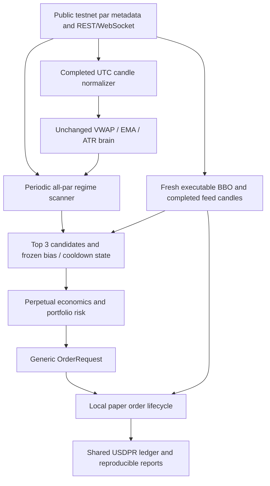

# Anchorium: frozen strategy, crypto paper infrastructure

This records the first paper checkpoint (595 tests). The subsequent
[recovery and risk-control guide](crypto_recovery_migration_2026-10-02.md)
records 645 tests, independent feed clocks, account-event reconciliation and
scoped circuit breakers. Existing dated probe artifacts below remain unchanged.

The authorized infrastructure migration is implemented in this clone. The old
NSE repository was not edited. `signal_brain.py` remains byte-identical to
`nse-working-baseline`; eight frozen management/observation methods and 32
parameters also verify. All exchange writes remain blocked. No wallet secret,
login, funding transfer or signed exchange call is part of this implementation.

## 1. Keep the execution lock and verify the baseline

Work from the existing repository root, on `perpetual-alpha-migration`. The tag
`nse-working-baseline` points to `ed0dba5b0577da38a500d9dc208fe9938d3f3a14`.
The project is identified as `anchorium-perpetual-alpha`; a folder rename is not
required to maintain the independent Git repository.

```ini
TRADING_VENUE=HYPERLIQUID_TESTNET
EXECUTION_MODE=PAPER
ALLOW_LIVE_ORDERS=false
```

These settings appear in the non-secret local `.env` and `.env.example`. Run:

```sh
.venv/bin/python scripts/check_strategy_freeze.py
.venv/bin/python scripts/phase0_check.py
```

Both checks must pass before a paper run. The new runner rejects contradictory
settings before contacting the venue. Runtime mode changes stop local order/fill
creation. Real order/cancel/leverage/transfer paths remain blocked even if a flag
is changed. Angel execution is permanently prohibited in this clone.

## 2. Understand the new data and execution path



Startup discovers the DEX index and every active market returned by
`meta(dex="par")`; it requires the ten published competition markets and includes
additional valid active par markets. Missing required markets or invalid metadata
abort startup. The scanner never silently substitutes native Hyperliquid markets.
Size decimals, asset mapping, maximum leverage and maintenance tiers come from
runtime metadata. An occupied market's specification change requires
reconciliation; idle specifications can refresh.

The adapter supplies the existing `Timestamp, Open, High, Low, Close, Volume`
DataFrame with UTC timestamps and fractional base volume. No synthetic missing
candles are inserted. UTC midnight remains the daily VWAP boundary. Other anchors
are rejected pending a separately authorized experiment. The new session manager
permits continuous operation and carries positions across UTC dates.

`strategy_contract.py` compiles only three hash-verified baseline management
methods into the new state adapter. It never executes the legacy module's imports,
constructor, broker code or Indian fee code. The unchanged methods preserve daily
bias, target ticks, completed-candle stops, 15-bar breakeven and 10-bar stop
cooldown. Continuous mode processes completed feed candles between periodic scans;
duplicate feed/REST bars cannot increment counters twice. Idle gaps preserve known
cooldown counts without inventing missing increments; held-position gaps pause new
entries until replay/review. Exit intent persists after a partial close.

## 3. Review portable selection and paper assumptions

Edit a separate copy of `docs/paper_policy.example.json` if paper infrastructure
assumptions need to differ, then pass `--config /absolute/path/policy.json`.
Preserve the frozen signal parameters and baseline scanner gates for this migration.

| Setting | Supplied value | Meaning |
| --- | --- | --- |
| Starting collateral | 20,000 USDPR | Hypothetical ledger balance, no wallet query |
| Scanner ATR floor | 0.004 fraction = 0.40% | Existing normalized scanner floor |
| Spread ceiling | 15 bps = 0.15% | Existing normalized spread ceiling |
| History / candidates | At least 300 completed minutes / up to 3 | Existing floor and candidate count |
| Volume / BBO filter | Positive window notional / at least 10 USDPR on both sides | Explicit paper selection assumptions |
| New setup risk / daily loss budget | 0.5% / 1% | Portable fractions replacing fixed INR budgets |
| Gross exposure / margin utilization | At most 1× equity / 50% equity | Explicit paper portfolio limits |
| Leverage / positions / daily setups | 1 / 1 global position / 2 | Leverage is a paper assumption; state caps retain baseline limits |
| Slippage / expected holding time | 5 bps per leg / 1 hour | Cost-gate assumptions, not a forced time exit |
| Maintenance buffer / mark-oracle basis | 2× estimated maintenance / 50 bps | Paper risk gates, not an exchange liquidation-price promise |

ATR and spread thresholds already used relative units in the old bot; they were
preserved rather than invented anew. The signal brain's own 0.06% ATR floor also
remains unchanged. The INR price band and five-million-share volume floor are
retired. Fractional contracts use runtime size precision. Stops/targets remain
VWAP reference ± 2 ATR / ± 4 ATR; only stock-specific two-decimal price rounding is
removed in the new body. All necessary adaptations and comparison checks are
listed in `infrastructure_adaptations.json`.

Qualified markets receive equal-weight percentile ranks for ATR fraction, tighter
spread, approximate window notional and BBO depth, with deterministic ties. EMA
strength, VWAP distance, realized volatility, funding and open interest appear in
diagnostics. Ranking selects candidates; the unchanged brain still decides LONG
or SHORT. No threshold was lowered to force a trade in the public probe.

## 4. Check perpetual accounting and order behavior

The default paper fee assumptions are 0.03% maker and 0.09% taker, based on the
competition guide checked on 2026-10-02. Actual team fee tiers remain unverified.
The guide describes hourly funding and shared USDPR collateral.
[Competition API guide](https://perpetual-alpha26.github.io/docs/).

The risk layer sizes against projected stop loss including fees, spread, slippage
and expected funding. Expected funding credits do not improve the entry gate.
It separately checks spread, data health, positive net edge and baseline net R:R,
exposure, free margin, runtime leverage tiers, stressed maintenance buffer, funding
cost and mark/oracle divergence. These checks live in the six requested modules
under `algo-trading-bot/risk/`.

The shared ledger accounts for perpetual contracts without deducting their entire
notional as a stock purchase:

```text
cash = starting USDPR + realized P&L - fees + signed funding cashflow
equity = cash + mark-based unrealized P&L
initial margin = sum(abs(quantity) × mark / leverage)
available margin = max(0, equity - initial margin - order reservations)
funding cashflow = -signed quantity × oracle × hourly decimal rate
```

Mark prices value unrealized P&L and margin; executable bid/ask prices determine
paper fills. Oracle prices determine funding notionals. Maintenance uses the
runtime leverage tiers with progressive deductions. The stress guard is an
estimate, not an exact venue liquidation engine.
[Hyperliquid margin tiers](https://hyperliquid.gitbook.io/hyperliquid-docs/trading/margin-tiers),
[funding](https://hyperliquid.gitbook.io/hyperliquid-docs/trading/funding).

Hourly public boundary snapshots are booked as `PAPER_SNAPSHOT_ESTIMATE`, not
actual wallet funding settlements. A missed boundary while exposed pauses new
entries; missing historical oracle/rate data is not fabricated. The present runner
does not automatically recover that accounting gap.

Both execution adapters accept generic `OrderRequest`. The paper adapter records
CREATED → SUBMITTED → ACKNOWLEDGED → OPEN, then FILLED, PARTIALLY_FILLED,
REJECTED or CANCEL_PENDING → CANCELLED. IOC remainders cancel. Reduce-only fills
cannot increase or flip a position. Request-level `ok` responses are decoded per
order so individual rejections are retained; this decoder is offline and sends
nothing to `/exchange`.

Paper fills use fresh displayed BBO, respect available size and consume a given
observation only once. There is no invented queue position or maker fill. The fee
schedule supports maker rates, but the current simulator fills taker orders only.
Fill/funding identities prevent duplicate ledger application. Actual exchange
latency, queue priority and forced liquidation are not simulated.

## 5. Run one bounded public-data paper cycle

Core dependencies are in `algo-trading-bot/requirements.txt`; optional legacy
regressions use `requirements-legacy.txt`. From the repository root:

```sh
.venv/bin/python scripts/run_crypto_paper.py --cycles 1
```

The command prints its fresh output directory under
`algo-trading-bot/data/crypto-paper/`. To choose a directory, add
`--output /absolute/path/new-paper-run`. Existing nonempty output directories are
rejected. No private key or public team wallet address is required.

## 6. Run continuous paper observations and inspect evidence

```sh
.venv/bin/python scripts/run_crypto_paper.py --cycles 0 --scan-interval-seconds 300
```

The scanner refreshes the entire active universe every five minutes. Public
WebSocket quotes and completed candles update position management between scans.
Separate public clients serve the scan, stream and main loop; only the main loop
owns ledger mutation. Stream warmup forbids entries. Ctrl-C ends the run without
an automatic end-of-day exit. A fresh process starts a new hypothetical ledger;
automatic restart/resume of old positions is not implemented.

| Artifact | What to review |
| --- | --- |
| `report.json` | Mode, provenance, every rejection reason, specs/policies, positions, fees/funding, equity, closed trades and drawdown |
| `events.jsonl` | Ordered local order/fill/funding events with observed book time and consumed depth |
| `equity.jsonl` | Mark-valued portfolio snapshots |
| `candles.jsonl` | Actual source candles used in each scan |
| `halt.json` / `shutdown.json` | Known positions and ledger facts when current valuation is unavailable; equity stays null |
| `failure.json` | Fatal run errors with exchange-order count zero |

Unrealized positions remain visible at shutdown. Review halts and preserve the last
good report; do not present stale valuation as current equity. Reports are local
paper evidence and cannot be submitted as actual wallet trades.

## 7. Report the measured result honestly

The public probe completed at **2026-10-02 07:52:08 UTC**:

| Observation | Measured result |
| --- | --- |
| Active markets scanned | 10 |
| Qualified watchlist / outcome | Empty / `NO_TRADE` |
| Local orders / local fills / exchange orders | 0 / 0 / 0 |
| Starting and ending equity | Hypothetical 20,000 USDPR |
| Realized P&L / fees / funding | 0 / 0 / 0 |
| Six markets | Stale completed candles: BTC, ETH, EWY, GOLD, USDEUR, USDJPY |
| EWJ | Insufficient completed history |
| BRENT, HYPE, SP500 | ATR below 0.40% and spread above 15 bps |

This validates connectivity, discovery, filtering and report generation. It gives
no profitable trading result or competition score. The exact report is
`crypto_public_paper_probe_2026-10-02.json`; source-bar/event hashes and paths are
recorded in `crypto_paper_validation_2026-10-02.json`. Raw runtime files remain
ignored by Git. The earlier failed serialization probe is preserved separately;
its NaN no-signal bug was fixed and regression-tested before the successful run.

Full offline validation passed **595 tests**, including **68 focused paper
infrastructure checks**. JUnit results are in `crypto_paper_tests_2026-10-02.xml`.
Tests cover accounting, funding causality, precision, partial exits, actual-BBO
close fills, state parity, continuous worker orchestration, policy lockout and
unavailable shutdown valuation. Synthetic tests are not performance evidence.
After the bounded REST probe, a short continuous public run also completed:

```sh
.venv/bin/python scripts/run_crypto_paper.py --cycles 2 --scan-interval-seconds 10 --output /absolute/path/new-continuous-probe
```

It produced two scans across ten markets, two equity snapshots and twenty
per-market source-history records. Its final report at **08:23:34 UTC** again
returned `NO_TRADE`: eight markets had stale completed candles and BTC/SP500
failed the ATR/spread gates. No local fills or exchange orders occurred, and no
failure/halt artifact was produced. The exact report is
`crypto_public_continuous_probe_2026-10-02.json`. Continuous orchestration is also
covered by offline tests. This short run checked feed startup and scanner/report
integration; the paper reports do not count WebSocket messages. Public streaming
message evidence is retained in the earlier separate data probe. A multi-hour
continuous public run with actual paper exposure remains to be observed.

For the hackathon, retain source/version, config, raw observations, paper provenance,
net returns, drawdown, fees/funding and exclusions together. Submit a team public
wallet address only after confirming the organizer's wallet/network requirements;
that address is for registration/read-only verification. Team wallet balances,
fee tiers and organizer funding still require manual verification. Any signed
trading implementation and activation require a future explicit instruction after
that verification. The current migration remains paper-only.
