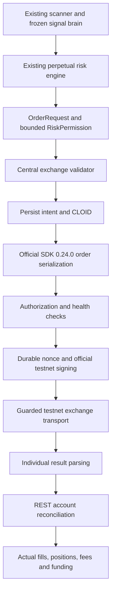

# Team Anchorium — production execution engineering report

Implementation started on 2 October 2026; final verification completed on 3 October 2026 (Asia/Kolkata), for Adesh and Parth. This report covers the new signed-execution phase. The earlier complete-project report remains a record of the project before this phase.

**Outcome:** the official-SDK execution infrastructure, exchange validator, account gates, durable recovery and offline integration tests are implemented. Development remains `EXECUTION_MODE=PAPER` and `ALLOW_LIVE_ORDERS=false`. No real exchange order, approval, transfer or account-mode change was submitted. Funded-account trading has not been verified.

## 1. Files modified

All paths below identify this isolated clone. The original NSE repository was not edited.

| Exact path | Why it changed |
| --- | --- |
| [/Users/adesh/Autonomous Trading Bot - Crypto /.gitignore](</Users/adesh/Autonomous Trading Bot - Crypto /.gitignore>) | Excludes live state directories, SQLite databases and signer leases from Git. |
| [/Users/adesh/Autonomous Trading Bot - Crypto /AGENTS.md](</Users/adesh/Autonomous Trading Bot - Crypto /AGENTS.md>) | Records the user's authorization for offline signing infrastructure while retaining the actual-submission prohibition and strategy freeze. |
| [/Users/adesh/Autonomous Trading Bot - Crypto /README.md](</Users/adesh/Autonomous Trading Bot - Crypto /README.md>) | Replaces the obsolete “signing not implemented” description and links the current readiness and execution guide. |
| [/Users/adesh/Autonomous Trading Bot - Crypto /algo-trading-bot/.env.example](</Users/adesh/Autonomous Trading Bot - Crypto /algo-trading-bot/.env.example>) | Adds an empty API-wallet public-address field. PAPER/false defaults remain unchanged; no secret value is included. |
| [/Users/adesh/Autonomous Trading Bot - Crypto /algo-trading-bot/requirements.txt](</Users/adesh/Autonomous Trading Bot - Crypto /algo-trading-bot/requirements.txt>) | Pins the official SDK to `hyperliquid-python-sdk==0.24.0`. |
| [/Users/adesh/Autonomous Trading Bot - Crypto /algo-trading-bot/exchange/hyperliquid_client.py](</Users/adesh/Autonomous Trading Bot - Crypto /algo-trading-bot/exchange/hyperliquid_client.py>) | Retains verified raw metadata, supports order-status reads, and optionally shares the rate manager. Existing PAPER/REPLAY callers keep their previous timing behavior. |
| [/Users/adesh/Autonomous Trading Bot - Crypto /algo-trading-bot/exchange/hyperliquid_execution.py](</Users/adesh/Autonomous Trading Bot - Crypto /algo-trading-bot/exchange/hyperliquid_execution.py>) | Replaces the blocked stub with a guarded executor supporting submit/place, cancel by OID/CLOID, modify, reduce-only close and policy leverage. Default construction remains blocked. |
| [/Users/adesh/Autonomous Trading Bot - Crypto /algo-trading-bot/exchange/order_lifecycle.py](</Users/adesh/Autonomous Trading Bot - Crypto /algo-trading-bot/exchange/order_lifecycle.py>) | Adds UNKNOWN and typed per-operation results, safe rejection classification and partial-IOC reporting. The existing paper response decoder retains its prior semantics. |
| [/Users/adesh/Autonomous Trading Bot - Crypto /docs/migration_policy.md](</Users/adesh/Autonomous Trading Bot - Crypto /docs/migration_policy.md>) | Distinguishes the earlier blocked-interface checkpoint from this later authorized infrastructure phase. |
| [/Users/adesh/Autonomous Trading Bot - Crypto /scripts/inventory_legacy_dependencies.py](</Users/adesh/Autonomous Trading Bot - Crypto /scripts/inventory_legacy_dependencies.py>) | Emits clean LF CSV records when refreshing the occurrence inventory. |
| [/Users/adesh/Autonomous Trading Bot - Crypto /docs/legacy_dependency_inventory.csv](</Users/adesh/Autonomous Trading Bot - Crypto /docs/legacy_dependency_inventory.csv>) | Refreshes occurrence locations and classifications after new infrastructure/documentation. |
| [/Users/adesh/Autonomous Trading Bot - Crypto /docs/legacy_dependency_inventory.json](</Users/adesh/Autonomous Trading Bot - Crypto /docs/legacy_dependency_inventory.json>) | Refreshes the corresponding inventory summary. |

No `.env` activation change, branch change, commit or push was made.

## 2. Files created

| Exact path | Responsibility |
| --- | --- |
| [/Users/adesh/Autonomous Trading Bot - Crypto /algo-trading-bot/exchange/exchange_rules.py](</Users/adesh/Autonomous Trading Bot - Crypto /algo-trading-bot/exchange/exchange_rules.py>) | One validator, risk-permission model and fresh public/team-account validation context. |
| [/Users/adesh/Autonomous Trading Bot - Crypto /algo-trading-bot/exchange/execution_journal.py](</Users/adesh/Autonomous Trading Bot - Crypto /algo-trading-bot/exchange/execution_journal.py>) | Durable intent/CLOID records, audit events, account checkpoints and management state; secret redaction. |
| [/Users/adesh/Autonomous Trading Bot - Crypto /algo-trading-bot/exchange/execution_safety.py](</Users/adesh/Autonomous Trading Bot - Crypto /algo-trading-bot/exchange/execution_safety.py>) | Manual approval, clock health, nonce leases/high-water marks and rate budgets. |
| [/Users/adesh/Autonomous Trading Bot - Crypto /algo-trading-bot/exchange/sdk_transport.py](</Users/adesh/Autonomous Trading Bot - Crypto /algo-trading-bot/exchange/sdk_transport.py>) | Official SDK serialization/signing and guarded testnet HTTP sink; separate in-memory fixture sink. |
| [/Users/adesh/Autonomous Trading Bot - Crypto /algo-trading-bot/exchange/live_readiness.py](</Users/adesh/Autonomous Trading Bot - Crypto /algo-trading-bot/exchange/live_readiness.py>) | Read-only checks for team identity, approved API wallet, expiry, unified mode, funding and health. |
| [/Users/adesh/Autonomous Trading Bot - Crypto /algo-trading-bot/exchange/live_recovery.py](</Users/adesh/Autonomous Trading Bot - Crypto /algo-trading-bot/exchange/live_recovery.py>) | Persists exchange truth and restores known frozen-manager state; pauses when history is missing. |
| [/Users/adesh/Autonomous Trading Bot - Crypto /algo-trading-bot/exchange/live_account_stream.py](</Users/adesh/Autonomous Trading Bot - Crypto /algo-trading-bot/exchange/live_account_stream.py>) | Raw team-account subscriptions and disconnect/reconnect REST barriers. |
| [/Users/adesh/Autonomous Trading Bot - Crypto /algo-trading-bot/exchange/live_portfolio.py](</Users/adesh/Autonomous Trading Bot - Crypto /algo-trading-bot/exchange/live_portfolio.py>) | Supplies the existing risk engine with reported equity and account buying power, without a paper ledger. |
| [/Users/adesh/Autonomous Trading Bot - Crypto /algo-trading-bot/exchange/live_runtime.py](</Users/adesh/Autonomous Trading Bot - Crypto /algo-trading-bot/exchange/live_runtime.py>) | Assembles a future explicitly approved session; contains no wallet creation or account-administration path. |
| [/Users/adesh/Autonomous Trading Bot - Crypto /algo-trading-bot/exchange/protective_orders.py](</Users/adesh/Autonomous Trading Bot - Crypto /algo-trading-bot/exchange/protective_orders.py>) | Disabled catastrophic-stop planning interface, separate from normal strategy exits. |
| [/Users/adesh/Autonomous Trading Bot - Crypto /algo-trading-bot/live_execution_session.py](</Users/adesh/Autonomous Trading Bot - Crypto /algo-trading-bot/live_execution_session.py>) | Connects the existing scanner/risk decisions to signed execution and actual-fill manager updates. |
| [/Users/adesh/Autonomous Trading Bot - Crypto /algo-trading-bot/live_session_results.py](</Users/adesh/Autonomous Trading Bot - Crypto /algo-trading-bot/live_session_results.py>) | Separate actual-account result files with explicit mode/source and candidate links. |
| [/Users/adesh/Autonomous Trading Bot - Crypto /algo-trading-bot/test_live_exchange_execution.py](</Users/adesh/Autonomous Trading Bot - Crypto /algo-trading-bot/test_live_exchange_execution.py>) | Focused offline signing, exchange-rule, recovery, safety and end-to-end fixtures. |
| [/Users/adesh/Autonomous Trading Bot - Crypto /scripts/check_live_readiness.py](</Users/adesh/Autonomous Trading Bot - Crypto /scripts/check_live_readiness.py>) | Read-only human-readable/JSON readiness probe; cannot load a signer or submit exchange actions. |
| [/Users/adesh/Autonomous Trading Bot - Crypto /docs/live_execution_readiness_2026-10-02.json](</Users/adesh/Autonomous Trading Bot - Crypto /docs/live_execution_readiness_2026-10-02.json>) | Actual public testnet probe and locked readiness snapshot. |
| [/Users/adesh/Autonomous Trading Bot - Crypto /docs/live_execution_tests_2026-10-02.xml](</Users/adesh/Autonomous Trading Bot - Crypto /docs/live_execution_tests_2026-10-02.xml>) | Final full-suite JUnit evidence. |
| [/Users/adesh/Autonomous Trading Bot - Crypto /docs/live_execution_validation_2026-10-02.json](</Users/adesh/Autonomous Trading Bot - Crypto /docs/live_execution_validation_2026-10-02.json>) | Repository, freeze, safety, suite and readiness evidence together. |
| [/Users/adesh/Autonomous Trading Bot - Crypto /docs/live_execution_engineering_report_2026-10-02.md](</Users/adesh/Autonomous Trading Bot - Crypto /docs/live_execution_engineering_report_2026-10-02.md>) | This implementation report and future operating procedure. |

The previous complete-project Markdown, Word and PDF files were preserved.

## 3. Strategy integrity and repository identity

The initial read-only inspection identified branch `perpetual-alpha-migration`, repository `Adesh2204/Autonomous-Trading-Bot-Crypto`, and HEAD `d6d6090c1d2066b3828105bdf0412e9f1d548d32`. The working tree already contained the earlier report artifacts. Those were not replaced.

Before editing, strategy-freeze verification passed: **one whole file, eight protected methods and 32 parameters**. Phase 0 passed **all 12 checks**. Both checks pass after implementation.

`signal_brain.py` remains byte for byte unchanged:

```text
SHA-256: bff940ac5ed35f71ed3dfb537ba15d20dcec35a4e62a938d2f0619c6e9309d83
Baseline: nse-working-baseline
Baseline commit: ed0dba5b0577da38a500d9dc208fe9938d3f3a14
```

The freeze manifest was not changed. VWAP, EMA9/EMA21, ATR, direction signals, bias, cooldown, warmup, stops and targets retain the validated baseline. Live management reuses `CryptoStrategyState` and the hash-verified baseline methods. No strategy file was rewritten to call Hyperliquid.

The architecture trace found the generic exchange models, paper executor/portfolio, public Hyperliquid client/data, account observer, reconciliation, risk modules, scanner, frozen managers, replay and result writer already reusable. The live stub and response decoder needed extension. Signed transport, durable signing controls, account-stream barriers and restart-safe live management were missing. The new code extends those boundaries; it does not introduce a second signal brain.

## 4. Real execution implementation

An order follows this path:



Production construction uses the official `Exchange` client with the testnet URL, API signer, `account_address=TEAM_WALLET_ADDRESS` and `perp_dexs=['par']`. Installed SDK method signatures and wire structures were inspected directly. The official constructor is also exercised under mocked public HTTP in tests.

The team wallet owns collateral, orders and positions. Every account query uses its public address. The API wallet is a different identity that signs trading actions; the bot never accepts the team private key. Signature-recovery tests prove that signed fixture actions recover to the API wallet.

SDK serialization is reused. Every Decimal passed through the SDK numeric interface must serialize back to the exact intended Decimal. The transport replaces the SDK's timestamp nonce with the leased durable nonce and re-signs through the SDK's official testnet signing function. Signed payloads do not enter journals or result artifacts.

Only order, cancel, CLOID cancel, modify and leverage actions can reach the production sink. Direct SDK posts and unarmed SDK actions are rejected. There is no approval, transfer, withdrawal or account-mode mutation capability in this runtime. HTTP redirects and automatic exchange retries are disabled.

The transport's target, precision/minimum/band rules and account setup match the current [Perpetual Alpha participant guide](https://perpetual-alpha26.github.io/docs/). SDK behavior was verified from installed version 0.24.0, rather than assumed from method names.

## 5. Pre-trade rules

The validator produces a structured allow/reject result and an audit record. It checks all of the following before the normal order path can sign:

1. The request is a valid generic order with a `par:` symbol present in the verified registry.
2. Runtime MarketSpec, asset mapping and metadata fingerprint match the expected venue.
3. Metadata, quote, mark context and account evidence are recent; missing clocks fail closed.
4. Side, order type and GTC/IOC/ALO semantics are supported.
5. Quantity rounds down to the runtime lot and remains positive; no order is enlarged.
6. Price uses the runtime Decimal normalizer, including five significant figures, the permitted decimal count, integer-price handling and safe buy/sell rounding.
7. Final normalized price times quantity meets the ten-USDPR minimum.
8. The limit remains within the permitted reference band. The audit retains reference price and deviation.
9. Selected leverage remains at the existing policy value and within runtime market/margin-tier limits.
10. Account mode, API approval/expiry, collateral and account queries pass readiness checks.
11. Risk permission binds candidate, market, direction, maximum quantity, freshness, reduction intent and price bound.
12. Opening exposure fits account-specific maximum size and buying power. Spot collateral is never substituted for free margin.
13. Opening exposure fits individual-market size/notional limits and the total DEX cap returned at runtime. Missing cap evidence rejects the opening order.
14. Reduce-only direction and quantity shrink an actual held position. The order cannot open, oversize or flip it. OI-cap checks are bypassed for this exposure reduction.
15. ALO cannot cross the current book; a proposed order cannot cross a known opposite-side team order.

No leverage increase, quantity increase, strategy threshold change or wider execution limit is used to rescue a rejection. Metadata/context failures pause entries. Exchange rejections retain safe reasons and structured codes; local OI rejection uses `OPEN_INTEREST_CAPACITY`.

## 6. Response parsing and partial execution

A request-level `status=ok` is not treated as order success. The new parser inspects each individual status. A mixed batch can therefore contain an open order and a rejection independently.

- `resting`: record its OID and OPEN state, without creating a fill.
- `filled`: record reported executed size, average price and OID. A smaller executed size remains PARTIALLY_FILLED.
- Partial IOC: retain the actual execution and mark the remainder cancelled.
- Unfilled IOC: report cancellation with no accounting fill.
- Individual `error`: record rejection and classified safe reason.
- Request failure: retain a typed request failure.
- Timeout or malformed/uncertain transmission result: record UNKNOWN and pause entries.

Order summaries describe the order response. They do not contain enough information to become accounting fills. The actual-fill reader remains authoritative. Invalid OIDs, impossible fill sizes and inconsistent status counts are rejected.

Close uses a validated reduce-only IOC with an explicit price bound and reason. It re-reads the actual position after the response. If quantity remains, the exit intent remains. The integration fixture opens a partial position, partially exits it, restarts with the remaining position and completes the same exit intent from recorded evidence.

## 7. Actual accounting and results

Live account truth reuses `HyperliquidAccount`, `HyperliquidReconciliation` and `ExchangeTruthState`. It is independent of `PaperPortfolio`.

Each actual fill retains exchange-reported size, price, fee, fee token, closed P&L, timestamp and identity. Deduplication uses the composite fill identity. Funding keeps the exchange-reported signed cash amount; no hourly estimate replaces it.

```text
Observed net realized P&L
= reported closed P&L
- actual fill fees
+ actual reported funding cash flow
```

Missing closed P&L leaves net P&L unknown and entries paused. Reported account value is retained directly rather than assembled by adding overlapping unified balances. The risk adapter uses account buying power and reported margin/equity; any maintenance amount it derives from runtime tiers is still an estimate for risk checks.

Actual result files include orders, fills, signals, rejected signals, health events, candidate traces, equity, positions, fees, funding, manifest and account report. CSV evidence preserves exchange/receive/process clocks; unknown exchange clocks remain null. Confirmed-order counts are separate from signed-attempt counts, and offline fixtures report zero real exchange submissions. The manifest includes Git identity, dirty source hash and risk policy. Every stream includes an explicit execution mode/source. Synthetic signed fixtures are labelled `OFFLINE_SIGNED_FIXTURE`; they are not competition trading results. PAPER and REPLAY outputs retain their original behavior.

A real transaction funding hash survives checkpoints unchanged. A restart test verifies that restoring a funding event cannot count its cash payment a second time. Secrets and signed payloads are excluded from exports.

## 8. Reconciliation: ambiguity, reconnect and restart

**Timeout:** persist the CLOID before transmission. Repeating the same durable logical intent returns the recorded outcome and never submits a second order. Recovery queries team-account order status by CLOID, open orders and recent fills. A returned OID links actual executions to the original candidate. `unknownOid` alone does not establish safe absence; this implementation keeps ambiguous intents blocked rather than automatically retrying them.

**Account streams:** subscribe to `userFills`, `orderUpdates`, `userEvents` and `userFundings` using the team address. Stream events wake REST reconciliation instead of inventing incomplete accounting fields. Disconnect, invalid subscription, wrong user or heartbeat expiry revokes entry readiness immediately. Reconnect requires all subscription acknowledgments and a stable REST snapshot before entry readiness returns.

**Restart:** startup is entry-locked. Restore durable account evidence and manager records, then fetch stable positions, orders, fills, funding and equity. Known manager state includes actual quantity, side, entry, stop, target, bias, cooldown, held-bar counter and candle cursor. Candidate links and processed fills are retained.

An untracked open order, unknown transmission, missing stop/target history, unexplained quantity change or inconsistent manager view keeps entries paused. Actual position evidence is adopted without “repairing” the exchange. Known management records are retained for review; missing geometry is never recreated from the current price. The journal must be reused on restart. Deleting it is not a recovery procedure.

Large history pages are explicitly refused by the existing account reader instead of silently truncating evidence. If an initial recovery exceeds those limits, an externally verified paginated account-history import is required before autonomous entry; no incomplete history is declared reconciled.

## 9. Safety controls and operating procedure

**Nonce safety:** a signer has one OS-level lease across processes, a bound persistent nonce database, serialized transactions and a durable increasing watermark. Concurrent threads cannot reuse a nonce. A second process, changed nonce store, deleted bound history, forked signer or excessive forward drift is rejected. Use a fresh API wallet when nonce history is lost; do not bypass the lease.

**Clock safety:** observed venue timing and wall/monotonic movement must be healthy. Stale reference, excessive skew or a wall-clock jump blocks signing. Clock thresholds are execution controls, not strategy changes.

**Rate safety:** one manager is shared by the assembled runtime. It records rolling IP weight, reported account budget, local reservations, daily actions, open-order count and error backoff. An opening order cannot use exhausted capacity; cancellation remains possible at the open-order ceiling when other budgets allow it. Uncertain signed requests are never retried automatically. Multiple unrelated clients on the same IP/account must be accounted for operationally; the runtime cannot observe every external process's request usage.

**Wallet lifecycle:** valid approval is checked again from current account reads. An expired API wallet is not ready. A previously verified approval that disappears is marked retired in persistent controls; reapproval of that same key does not clear retirement. Replacement requires a fresh key.

**Lockout:** PAPER/false remains unchanged. A production session additionally requires an actual SDK-compatible API signer and a distinct, time-limited, manually verified approval object matching both identities, explicit future testnet-live configuration, funded/approved unified account, account recovery, stream readiness and fresh validation. This task does not create that authorization. A readiness report cannot claim LIVE_READY from an authorization object alone: it must also inspect a fully configured production executor, its signer, account/stream recovery and current health. Offline transports cannot produce LIVE_READY.

**Catastrophic stop:** a disabled planner can construct a separately authorized reduce-only trigger plan under tests. It cannot activate one. No arbitrary protective price is introduced, and normal candle-close stop behavior is unchanged. Activating exchange-side catastrophe protection remains a separate implementation/authorization step.

### Future activation, after organizer funding and separate human authorization

1. Confirm the team public address with the organizers. The team private key stays outside the bot.
2. Verify positive USDPR, unified account mode and approved, unexpired API-wallet address. Perform account administration with your own wallet tooling; the bot cannot perform it.
3. Run the read-only probe with the two public addresses. Resolve every reported reason.
4. Choose one persistent account state directory/session and keep the same journal, accounting origin and nonce store across restart. Use one signing process.
5. Reverify the current venue fee scale and use current reported base user rates for risk estimates. Actual accounting still uses actual fill fees.
6. Reconcile held positions/open orders and restore strategy-management history. Resolve every unknown intent and manual-review condition.
7. Only after a new explicit authorization: select `HYPERLIQUID_TESTNET_LIVE`, set the permission flag, provide a bounded `HumanLiveApproval`, and supply the API signer through private credential management. No team key is accepted. The future assembly function checks configuration before loading an API key.
8. Run a tiny controlled testnet entry, inspect actual fill/fee, reduce-only close, verify flat and reconcile reported P&L.
9. Verify LONG, SHORT, cancellation, partial execution, reconnect and restart behavior against the funded account before autonomous practice. Offline tests cannot replace this verification.

### Emergency deactivation

Revoke `LiveRuntime.authorization` through `deactivate()` and pause entries immediately. Restore PAPER/false before any restart. Keep the journal and account evidence. Deactivation does not claim positions are flat and does not submit an emergency liquidation. Inspect the actual team account and manage remaining exposure through separately authorized wallet/exchange tooling. Remove a compromised agent using team-wallet administration and replace its key.

## 10. Test results and evidence

Final validation runs the entire project suite, including the unchanged PAPER and REPLAY tests and **83 new focused cases**:

```sh
.venv/bin/python -m pytest algo-trading-bot -q --disable-warnings --junitxml=docs/live_execution_tests_2026-10-02.xml
.venv/bin/python scripts/check_strategy_freeze.py
.venv/bin/python scripts/phase0_check.py
```

The final exact suite count is recorded in `live_execution_validation_2026-10-02.json` and the JUnit XML. The completed run passed **761 tests, with 0 failures and 0 errors**, in 57.83 seconds. The result must be read from those artifacts if the source changes later.

New categories cover every requested test area: namespace/spec identity; down-only size; Decimal prices; minimum/band/margin/leverage/OI; reduce-only; individual/batch outcomes; partial/unfilled IOC; CLOID idempotence; timeout recovery; actual P&L/fees/funding; wallet separation/expiry/retirement; stale metadata; stream reconnect; open-position/order/partial restart; rates; thread/process nonces; clocks; redaction; default lockout; full live-owner integration; results deduplication; unchanged strategy hash.

Representative integration tests include:

- `test_official_signing_uses_api_wallet_testnet_domain_and_team_account`
- `test_timeout_never_resubmits_and_unknown_oid_does_not_prove_absence`
- `test_uncertain_request_recovered_from_cloid_and_actual_fills`
- `test_close_partial_fill_rechecks_authoritative_position_retains_exit_intent`
- `test_live_signal_risk_signed_entry_actual_partial_exit_restart_and_results`
- `test_websocket_disconnect_reconnect_team_subscriptions_rest_barrier`
- `test_real_transaction_funding_hash_survives_checkpoint_without_double_accounting`
- `test_restarting_signer_with_new_nonce_store_cannot_reuse_nonce`
- `test_official_production_constructor_selects_par_and_keeps_default_authorization_locked`

All signed tests use synthetic public identities and ephemeral API signers with HTTP exchange access blocked. The separate actual public probe only calls `/info`. It discovered runtime DEX index 257, all ten markets and healthy timing. This confirms public connectivity, not actual funded-account execution.

## 11. Remaining blockers and practical limits

The following remain external prerequisites:

- Team Anchorium public wallet configuration and organizer funding.
- A separately approved API wallet, verified expiry and confidential signer provisioning.
- Verified unified-account mode and USDPR buying power.
- Full actual-account reconciliation with management history for existing exposure.
- Separate explicit activation authorization.
- Controlled funded testnet order, fill, close, fee/P&L and reconnect/restart verification.

The read-only probe currently has neither public wallet configured. There are no real results to submit from this phase. Offline fixture returns must never be presented as competition performance.

The execution architecture is implemented and regression-tested; actual exchange acceptance, account stream behavior for this team's funded wallet and operational reliability remain unverified until the controlled future practice step. The catastrophe-stop feature is intentionally a non-submitting planning interface. Large initial account-history pages remain a fail-closed manual/pagination prerequisite rather than a silently shortened record.

## 12. Final readiness state

```text
MARKET_DATA_READY = true       (actual public testnet probe)
PAPER_READY = true             (public probe and full regression suite)
SIGNED_TRANSPORT_IMPLEMENTED = true
ACCOUNT_READY = false         (team/API wallets and funding not verified)
LIVE_READY = false
ALLOW_LIVE_ORDERS = false
EXECUTION_MODE = PAPER
FINAL_STATUS = ACCOUNT_SETUP_REQUIRED
```

These are observations for this checkpoint. A connection, address, successful fixture signature or configuration flag alone cannot change the live readiness conclusion.
