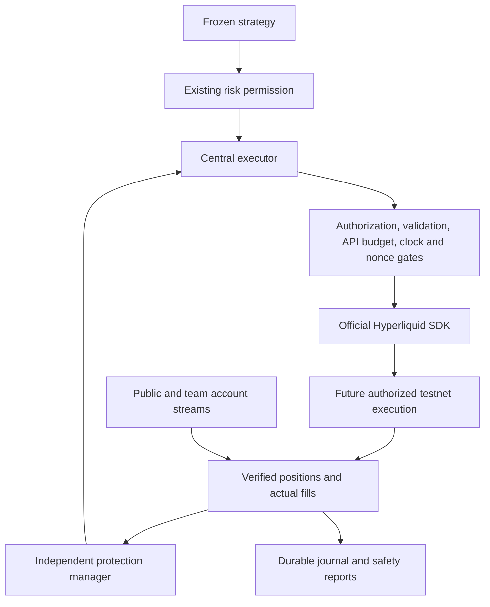

# Team Anchorium — Production reliability report

**Project:** Anchorium Autonomous Trading Bot · **Date:** 3 October 2026  
**Venue:** Hyperliquid Testnet · **DEX:** `par` · **Collateral:** USDPR  
**Development settings:** `EXECUTION_MODE=PAPER`, `ALLOW_LIVE_ORDERS=false`

The bot now has a shared API safety system and a complete independent catastrophic protection manager. The strategy source, normal stops, targets and decision rules remain unchanged. All exchange submissions in this work were simulated in memory. **Actual exchange submissions: zero.** Catastrophic protection is disabled in the supplied configuration; its production distance and slippage settings remain unset.

This report describes implementation and verification. It contains no real trading returns, competition score or claim that a funded account is ready.

## 1. Audit findings

Before changing code, the repository was clean on `perpetual-alpha-migration` at commit `519d6763d277a66c80cac26ba4b114c4dbb98ad5`. Strategy freeze and all 12 Phase 0 checks passed. Work was confined to this cloned repository. The original NSE repository was not edited.

The project already had a frozen signal brain, generic market/account interfaces, PAPER and REPLAY execution, official SDK execution, risk permissions, an exchange validator, durable order CLOIDs, actual-fill accounting, recovery and account streams. These components were extended rather than replaced.

| Gap found | Why it mattered | Implemented response |
|---|---|---|
| API limits did not have explicit priorities or reserves | Optional work could consume capacity needed to manage exposure | Shared priorities, entry reserves and explicit health states |
| Account budget refresh reset local reservations | A lagging response could make spent capacity appear available again | Persisted outstanding reservations and monotonic budget observations |
| No shared WebSocket budget accounting | Duplicate subscriptions and repeated reconnects could exhaust capacity | Connection, subscription, user, message, heartbeat and reconnect tracking |
| Clock health was a boolean | Recovery from a clock fault was difficult to audit | HEALTHY/WARNING/UNSAFE states with fresh recovery confirmation |
| Nonce faults were not persistently latched | Restarting could resume signing without reviewing the cause | Persistent degraded state and explicit reviewed recovery |
| Process ownership lacked readable metadata | A second process was difficult to diagnose | Exclusive lock plus public PID/host/start/address metadata |
| Catastrophic protection only had a planner | A planned stop was not an installed and verified exchange order | Independent create/verify/modify/cancel/recover lifecycle |
| Ordinary management uncertainty was mainly an event | An uncertain cancellation or leverage action needed a durable barrier | Management action journal and read-only outcome recovery |
| Account history could restart from the full origin after an event | Repeated large downloads wasted API weight | Continue from the persisted verified window with an overlap |

The pre-edit hashes and findings are recorded in [the initial audit](</Users/adesh/Autonomous Trading Bot - Crypto /docs/reliability_initial_audit_2026-10-03.json>).

The final architecture is:



The default PAPER/false boundary prevents the future execution path from reaching the exchange.

## 2. Files modified

Each linked path is the actual file in this workspace.

| File | Responsibility changed |
|---|---|
| [AGENTS.md](</Users/adesh/Autonomous Trading Bot - Crypto /AGENTS.md>) | Records the new directive while preserving strategy and activation restrictions |
| [README.md](</Users/adesh/Autonomous Trading Bot - Crypto /README.md>) | Explains the new reliability phase and verification commands |
| [execution_safety.py](</Users/adesh/Autonomous Trading Bot - Crypto /algo-trading-bot/exchange/execution_safety.py>) | Durable nonce fault latch, canonical process lease, ownership metadata and clock states; retains the rate-manager compatibility import |
| [execution_journal.py](</Users/adesh/Autonomous Trading Bot - Crypto /algo-trading-bot/exchange/execution_journal.py>) | Durable management action attempts and pending-outcome lookup |
| [hyperliquid_client.py](</Users/adesh/Autonomous Trading Bot - Crypto /algo-trading-bot/exchange/hyperliquid_client.py>) | Central safe-read retry/priority path, HTTP backpressure classification and `frontendOpenOrders` DEX selection |
| [hyperliquid_account.py](</Users/adesh/Autonomous Trading Bot - Crypto /algo-trading-bot/exchange/hyperliquid_account.py>) | Validated trigger-aware account order reads using the TEAM address |
| [exchange_rules.py](</Users/adesh/Autonomous Trading Bot - Crypto /algo-trading-bot/exchange/exchange_rules.py>) | Fresh REST safety context during stream failure; dormant triggers are distinguished from executable self-crossing orders |
| [hyperliquid_execution.py](</Users/adesh/Autonomous Trading Bot - Crypto /algo-trading-bot/exchange/hyperliquid_execution.py>) | Shared entry/safety gates, official trigger submit/modify/cancel paths, persistent nonce-error handling and uncertain management recovery |
| [sdk_transport.py](</Users/adesh/Autonomous Trading Bot - Crypto /algo-trading-bot/exchange/sdk_transport.py>) | Official SDK trigger serialization and safe HTTP status classification; signed actions still have no automatic retry |
| [hyperliquid_market_data.py](</Users/adesh/Autonomous Trading Bot - Crypto /algo-trading-bot/exchange/hyperliquid_market_data.py>) | Public WebSocket budget registration, message tracking and cleanup |
| [live_account_stream.py](</Users/adesh/Autonomous Trading Bot - Crypto /algo-trading-bot/exchange/live_account_stream.py>) | Shared account-stream budgets and protection verification after reconnect/reconciliation |
| [live_recovery.py](</Users/adesh/Autonomous Trading Bot - Crypto /algo-trading-bot/exchange/live_recovery.py>) | Protection identity recovery before fill attribution, trigger child IDs, management ambiguity barriers and bounded incremental history |
| [live_runtime.py](</Users/adesh/Autonomous Trading Bot - Crypto /algo-trading-bot/exchange/live_runtime.py>) | Future runtime assembly with explicit protection policy, shared reliability objects and managed public stream lifetime |
| [live_readiness.py](</Users/adesh/Autonomous Trading Bot - Crypto /algo-trading-bot/exchange/live_readiness.py>) | Separate safety capacity from entry permission; live readiness requires nonce/protection health |
| [live_execution_session.py](</Users/adesh/Autonomous Trading Bot - Crypto /algo-trading-bot/live_execution_session.py>) | Protection/account barriers, actual catastrophic fill attribution, cached trusted checkpoint use and flat-before-flip verification |
| [live_session_results.py](</Users/adesh/Autonomous Trading Bot - Crypto /algo-trading-bot/live_session_results.py>) | Protection event exports and readable/JSON production safety snapshots |
| [circuit_breakers.py](</Users/adesh/Autonomous Trading Bot - Crypto /algo-trading-bot/risk/circuit_breakers.py>) | Account-wide operational gates and protection incidents, preserving existing symbol-specific gates |
| [protective_orders.py](</Users/adesh/Autonomous Trading Bot - Crypto /algo-trading-bot/exchange/protective_orders.py>) | Clarifies that this is the retained legacy planner; its old activation method stays locked |
| [check_live_readiness.py](</Users/adesh/Autonomous Trading Bot - Crypto /scripts/check_live_readiness.py>) | Loads public safety policy and adds production safety output without constructing a signer |
| [legacy dependency inventory CSV](</Users/adesh/Autonomous Trading Bot - Crypto /docs/legacy_dependency_inventory.csv>) and [JSON](</Users/adesh/Autonomous Trading Bot - Crypto /docs/legacy_dependency_inventory.json>) | Refreshed occurrence locations and classifications after the source/documentation changes |

No protected strategy file, freeze manifest or strategy parameter was edited. Neither runtime safety environment file was changed to enable orders.

## 3. Files created

| File | Purpose |
|---|---|
| [reliability_policy.py](</Users/adesh/Autonomous Trading Bot - Crypto /algo-trading-bot/exchange/reliability_policy.py>) | Explicit priorities/states, rate policy and strict public JSON policy loader |
| [rate_limits.py](</Users/adesh/Autonomous Trading Bot - Crypto /algo-trading-bot/exchange/rate_limits.py>) | Shared REST/account/daily/WebSocket budgeting and safe read backoff |
| [position_protection.py](</Users/adesh/Autonomous Trading Bot - Crypto /algo-trading-bot/exchange/position_protection.py>) | Independent catastrophic policy, plans, exchange ownership verification and lifecycle |
| [stream_first.py](</Users/adesh/Autonomous Trading Bot - Crypto /algo-trading-bot/exchange/stream_first.py>) | Uses trusted quotes/books/completed candles from the public stream; falls back to REST when required |
| [safety_report.py](</Users/adesh/Autonomous Trading Bot - Crypto /algo-trading-bot/exchange/safety_report.py>) | Secret-free operational safety snapshots and a readable formatter; reporting performs no API calls |
| [test_production_reliability.py](</Users/adesh/Autonomous Trading Bot - Crypto /algo-trading-bot/test_production_reliability.py>) | 83 new offline reliability/protection/failure-injection cases |
| [reliability_policy.json](</Users/adesh/Autonomous Trading Bot - Crypto /configs/reliability_policy.json>) | Documented development policy, with catastrophic protection disabled and distance unset |
| [verify_reliability_strategy_parity.py](</Users/adesh/Autonomous Trading Bot - Crypto /scripts/verify_reliability_strategy_parity.py>) | Repeatable pre-upgrade/current strategy comparison on identical inputs |
| [initial audit JSON](</Users/adesh/Autonomous Trading Bot - Crypto /docs/reliability_initial_audit_2026-10-03.json>) | Repository identity, protected hashes and pre-edit findings |
| [strategy parity JSON](</Users/adesh/Autonomous Trading Bot - Crypto /docs/reliability_strategy_parity_2026-10-03.json>) | Exact output comparisons for six input sets |
| [public readiness JSON](</Users/adesh/Autonomous Trading Bot - Crypto /docs/production_safety_readiness_2026-10-03.json>) | Genuine public testnet observation with account/LIVE still unverified |
| [full regression XML](</Users/adesh/Autonomous Trading Bot - Crypto /docs/reliability_regression_2026-10-03.xml>) | Machine-readable final full-suite results |
| [replay/parity XML](</Users/adesh/Autonomous Trading Bot - Crypto /docs/reliability_replay_parity_2026-10-03.xml>) | Dedicated existing replay, migration and paper/strategy verification |
| [validation JSON](</Users/adesh/Autonomous Trading Bot - Crypto /docs/reliability_validation_2026-10-03.json>) | Consolidated results, scope, hashes, failure cases and readiness |
| [this report](</Users/adesh/Autonomous Trading Bot - Crypto /docs/production_reliability_report_2026-10-03.md>) | Plain-language engineering handover in the requested 12-part format |

## 4. RateLimitManager

An API has a limited amount of traffic it can accept. Market reads and signed account actions consume different kinds of capacity. The manager tracks those separately, rather than treating every request as one interchangeable call.

Before REST calls it reserves expected IP weight. After historical responses it adds the result-dependent weight. Actual returned account evidence is retained even if that extra cost pushes local usage over the limit. Signed operations are counted individually, and local actions are stored by UTC date, process, public API-wallet address, session and action type.

The account budget comes from `userRateLimit` using the **TEAM wallet**, never the API wallet. The manager records used requests, capacity, remaining capacity and refresh time. A repeated old response does not reset locally reserved actions. Outstanding reservations and the exhausted-budget safety interval survive restart.

Current venue limits and account-budget semantics were checked against [official rate documentation](https://hyperliquid.gitbook.io/hyperliquid-docs/for-developers/api/rate-limits-and-user-limits). The unified daily ceiling is also described in the [competition guide](https://perpetual-alpha26.github.io/docs/). These are configurable policy values, rather than strategy constants.

| Policy/default | Meaning |
|---|---|
| IP weight 1,200 per minute | Rolling local REST/action usage |
| IP safety reserve 120 | Headroom withheld from ordinary calls |
| Daily actions 50,000; reserve 500 | Pause entries before the local daily ceiling |
| Account action reserve 10 | New entries cannot spend the last reserved actions |
| Open orders 1,000 | Conservative cap that also protects trigger/reduce-only placement |
| WebSockets 10 connections, 1,000 subscriptions, 10 users | Shared aggregate budgets |
| WebSocket messages 2,000 per minute | Includes subscription messages and heartbeats |
| Reconnect policy 5 new connections per minute | Operational limit below the venue's 30-per-minute ceiling |
| Budget maximum age 60 seconds | Old account budget is not treated as current |
| Optional polling interval 5 seconds | Four times slower in CAUTION |
| Read retry attempts 3 | Only transient failures on idempotent reads |
| Backoff base 1 second; cap 30 seconds | Exponential delay with bounded jitter; numeric Retry-After is respected within the cap |
| Exhausted-account safety interval 10 seconds | Restricted critical-action allowance; persisted across restart |
| CAUTION at 75%; THROTTLED at 90% IP usage | Also considers remaining account/daily capacity and backpressure |

Reserves are engineering defaults. They must be reviewed against the number of positions and processes in an authorized deployment. A reserve does not override an exchange ceiling.

| Priority | Work | Behavior under pressure |
|---|---|---|
| 0 — SAFETY | Position/protection verification, reductions, emergency cleanup, uncertainty recovery | Retains reserved capacity |
| 1 — EXECUTION | Ordinary entries, modifications and cancellations | Entries stop before consuming safety reserves |
| 2 — DECISION | Fresh market/account/risk context | Cannot spend the safety reserve |
| 3 — OPTIONAL | Extra history, analytics, diagnostics and reports | Slowed or blocked first |

States are `HEALTHY`, `CAUTION`, `THROTTLED`, `EXHAUSTED` and `UNKNOWN`. Missing/stale budget restricts optional activity. Exhaustion blocks entries while preserving the modeled critical allowance. Safety reads remain possible during ordinary backoff, within physical IP limits. Safety signing still needs valid authorization, account evidence, clock and nonce health.

Only safe `/info` reads retry after timeout/connection failure, HTTP 429 or server failure. Validation/schema errors do not retry. **Signed transmission never enters this retry function.** Uncertain orders are recovered by CLOID/status, open orders, fills and actual positions. Unknown OID alone never proves that an order was not accepted. Uncertain cancels and leverage changes also remain durable until read-only account evidence resolves them.

WebSocket cleanup releases subscriptions when connections close. Duplicate subscriptions do not send another message. Reconnects rebuild the desired subscriptions, and reconnect storms are restricted. Trusted public streams supply quotes, books and completed candles; an acknowledged healthy account stream avoids repeating a full account checkpoint for every scanned symbol. REST remains the source for stable recovery after material account events or uncertainty.

Local IP/daily/action counters are operational evidence. They do not measure unrelated programs sharing an IP or all external activity on the team account, and do not supersede exchange-reported limits. Historical page-limit failures remain explicit review barriers rather than incomplete accounting presented as complete.

## 5. NonceManager

A nonce is the unique ticket number attached to a signed request. Reusing it can cause rejection or replay problems. All transmitted SDK actions obtain their nonce through one manager:

```text
next_nonce = max(current_time_in_milliseconds, previous_nonce + 1)
```

A thread lock serializes allocation. An immediate SQLite transaction stores the high-water mark with full synchronization before the signed payload can be sent. Same-millisecond calls are unique; concurrent calls are unique; a rapid restart reads the previous value. Small backward clock movement cannot make the value decrease. A value more than 5 seconds ahead of the current clock is rejected by the local drift guard.

A venue nonce error writes a persistent degraded state. Signing remains blocked after restart. Recovery requires an explicit `manually_verified=True` decision, fresh healthy clock evidence, correct process ownership and a valid stored high-water mark. This task never performed such recovery on a real wallet.

The SDK's internal preliminary timestamp/signature is replaced before transmission and re-signed with the official SDK function using the centralized nonce. Preliminary SDK signatures are neither transmitted nor logged. The exchange's own nonce model and API-wallet lifecycle are described in [official nonce documentation](https://hyperliquid.gitbook.io/hyperliquid-docs/for-developers/api/nonces-and-api-wallets).

## 6. ClockHealthMonitor

The monitor compares wall time with monotonic elapsed time, and checks a fresh exchange event timestamp against the request/response interval. It reports:

| State | Meaning |
|---|---|
| HEALTHY | Recent acceptable reference with no detected wall-clock jump |
| WARNING | Missing/stale/unreliable evidence, or recovery still needs confirmation |
| UNSAFE | Excessive skew or a backward/forward wall-clock jump |

Defaults are 2 seconds maximum skew and 30 seconds reference age. A reference taking more than 2 seconds round trip is rejected. Following a fault, two fresh advancing references are required; rereading the same timestamp does not count as a second confirmation. A warning never becomes healthy just because time passes. Both WARNING and UNSAFE prevent signing.

A cached quote is not relabelled as a new server-time observation. A fresh REST book is used when clock evidence must be refreshed. A book timestamp is exchange-event evidence, not a certified time service, so operating-system time synchronization is still required.

For deployment, keep automatic time enabled on macOS, or verify the configured NTP/chrony service on Linux. After a clock incident, reconcile the account and obtain fresh clock confirmation before reviewing nonce recovery. Do not change strategy parameters to work around a clock fault.

## 7. API-wallet process safety

One signing API wallet has an exclusive OS file lock for its process. The lease namespace uses canonical `/tmp`, so a second process cannot bypass it by changing `TMPDIR`. The ownership record contains PID, hostname, start time, public API-wallet identity and nonce-database location. It contains no private key.

The nonce-store binding is immutable after creation. Ownership metadata is written separately with an atomic file replacement; updating a PID does not truncate the critical binding. A missing/corrupt binding or changed/missing nonce store refuses reuse. The second process is rejected; no process is killed and no wallet is automatically replaced.

The OS lease covers this operating-system user on this host. Other hosts, containers or users must use separate API wallets. The local lock cannot coordinate private-key copies on remote machines. Never reuse a removed, expired or retired API-wallet key; use a fresh wallet through the separately approved account setup process.

## 8. Catastrophic protection

The normal strategy stop still uses the existing frozen management logic. Catastrophic protection is a separate exchange-side guard for failure or extreme movement. The strategy does not calculate API budgets, allocate nonces or construct trigger requests.

The production formula is explicit, with **no supplied production multiplier or slippage value**:

```text
LONG trigger  = current normal strategy stop - approved multiplier × stored entry ATR
SHORT trigger = current normal strategy stop + approved multiplier × stored entry ATR

LONG execution limit  = trigger × (1 - approved slippage fraction)
SHORT execution limit = trigger × (1 + approved slippage fraction)
```

Runtime precision is applied. A rounded trigger must remain strictly farther than the normal stop. It must be positive, correctly placed relative to the current mark, and not beyond a reported liquidation boundary. Invalid geometry, missing management history or unapproved policy produces a safety incident, never a guessed stop. The minimum-order check remains enforced. The supplied policy has `enabled=false` and null distance/slippage fields. Test multipliers are synthetic fixtures, not production recommendations.

The official SDK encodes a stop-loss trigger with `isMarket=true` and `reduce_only=true`. LONG exposure creates SELL protection; SHORT exposure creates BUY protection. Quantity comes from fresh actual positions and must match the known management state. It is never based on the requested entry size. The shared validator, authorization, nonce and clock gates apply to protection too. The [competition order guide](https://perpetual-alpha26.github.io/docs/) documents the underlying trigger/reduce-only semantics.

| Status | Plain-language meaning |
|---|---|
| NOT_REQUIRED | Verified flat, with no owned stale protection left |
| PENDING | A specific durable protection attempt is being prepared/verified |
| ACTIVE | Exactly one owned open stop matches direction, size, trigger, limit and reduce-only fields |
| PARTIAL | Existing coverage does not match the position; repair is required |
| MISSING | Exposure needs protection and none has been verified |
| ERROR | Policy, data, identity, submission or verification failed |
| OBSOLETE | Old protection needs cancellation and confirmation |

A correct existing stop causes no new action. Additional fills or partial exits use an atomic SDK modification to match the actual remaining quantity. A wrong-direction/non-reduce-only owned stop is canceled and verified absent before replacement. A flat position cancels obsolete owned protection and verifies that it is gone. Direction-flip entry waits for actual flat and old protection cleanup.

Ownership comes from durable, deterministic CLOIDs classified `CATASTROPHIC_STOP`, separate from entry and normal strategy exit. `frontendOpenOrders` supplies trigger fields and `orderStatus` verifies the same order's identity, status and parameters. Contradictory snapshots, duplicates and unrecognized manual triggers stop readiness. The manager does not adopt or cancel an unrelated manual order. The [official info schema](https://hyperliquid.gitbook.io/hyperliquid-docs/for-developers/api/info-endpoint) defines these read interfaces.

A restart can discover a known exchange trigger even if the lifecycle record was lost. Identity recovery runs before fill attribution, including verified terminal trigger children. Actual catastrophic fills close/reduce the existing manager using reported executions. If a trigger partially executes, child status, open-order absence and fills must prove that no pending remainder remains before a new guard is considered. Unknown child schemas/outcomes remain review barriers.

Timeout after signing produces UNKNOWN. The next ensure call queries exchange identity instead of sending another stop. If the stop exists, it is verified and adopted. If its outcome is still unprovable, entries stay paused. A PREPARED record has a different meaning: the program persisted SUBMITTED before every SDK call, so a crashed PREPARED attempt provides non-transmission evidence. A local API reservation denial is also explicitly recorded as not transmitted.

On a disconnect, new entries pause. Reconnect requires account subscriptions, stable account recovery and actual protection verification. Missing/error coverage raises account-wide entry controls and, where appropriate, an EMERGENCY risk state. Existing strategy geometry is retained. Fresh REST context permits separately authorized reduce/protection handling while a stream is down; it does not authorize new entries or bypass clock/nonce faults.

A trigger is not a guaranteed fill price. Limited liquidity, slippage limits, shared margin and a gap can still affect execution. The system verifies actual fills and remaining exposure rather than claiming that an acknowledged trigger has already closed a position. Neither optional take-profit triggers nor `schedule_cancel` are dependencies of this protection system.

Safety exports include symbol, quantity, direction, entry, normal stop, catastrophic trigger, CLOID/OID, status and timestamps. `protection_events.jsonl`, `production_safety.json` and `production_safety.txt` let the team inspect what was verified at a particular observation time. Failed discovery changes readiness and the reported verification state; an old ACTIVE label is not reused as fresh confirmation. Every new entry also compares the fresh actual position quantity and direction with verified protection and saved management. A restored checkpoint without a fresh account observation is reported as UNKNOWN, even if its persisted positions are empty.

## 9. Strategy integrity

All freeze checks pass: **1 protected whole file, 8 protected methods and 32 protected parameters**. `signal_brain.py` remains byte-for-byte unchanged:

```text
bff940ac5ed35f71ed3dfb537ba15d20dcec35a4e62a938d2f0619c6e9309d83
```

Baseline tag: `nse-working-baseline`, commit `ed0dba5b0577da38a500d9dc208fe9938d3f3a14`. The manifest was not rewritten. VWAP, EMA9/EMA21, ATR, LONG/SHORT and breakout/pullback conditions, warmup, thresholds, daily bias, cooldown, anti-spam, candle-close stops, targets and direction-flip decision rules were preserved.

The pre-upgrade source and current source were executed on the same six inputs: warmup, flat, uptrend, downtrend, volatile and UTC day boundary. **All output columns matched exactly over 2,050 candles.** This includes nonzero examples of every signal type. Existing baseline management parity tests also pass, covering normal target, candle-close stop, breakeven and cooldown behavior.

Safety gates can pause entries when operational evidence is insufficient. That is an infrastructure restriction, not a change to signal frequency or strategy parameters.

## 10. Test results

Final verification:

| Check | Result |
|---|---|
| Full pytest suite | **844 passed, 0 failed** |
| Existing tests retained | **761 passed** |
| New reliability/protection tests | **83 passed** |
| Focused official execution + new reliability suite | **166 passed** |
| Dedicated replay/migration/paper parity group | **169 passed** |
| Strategy freeze | Passed: 1 file, 8 methods, 32 parameters |
| Phase 0 | All 12 checks passed |
| Pre/current signal comparison | Six fixtures, 2,050 candles, exact equality |
| Whitespace/diff validation | Passed |
| Actual exchange submissions | **0** |

The subset counts overlap the full suite and must not be added to it. Offline signing used ephemeral API wallets and a concrete in-memory transport with HTTP disabled. Synthetic positions/fills are labelled as fixtures; they are not reported competition results.

All seven requested failure-injection situations are covered:

| Failure | Verified response |
|---|---|
| Internet disappears immediately after entry fill | Durable UNKNOWN; no duplicate entry; actual fills/position recovered before protection |
| Crash before local protection lifecycle is saved | Exchange trigger rediscovered by durable CLOID without another order |
| Protection submission times out | Accepted stop adopted when provable; unproven outcome remains paused |
| Budget nearly/exhausted with exposure | Entries/optional work stop; safety capacity remains available under policy |
| Clock becomes unsafe | Signing blocked; management retained and account reads available |
| Second process uses the same API wallet | Lease conflict rejects it, including a different TMPDIR |
| Partial entry followed by crash | Saved management restored; exact actual partial quantity protected |

Additional cases cover long/short direction, atomic grow/shrink, full exit cleanup, reconnect, actual catastrophic child fills, unknown children, contradictory status snapshots, stale/changed positions, duplicate/manual stops, individual rejection handling, subminimum remainder, secret-free exports, 429 jittered read backoff and durable cancel/leverage recovery.

## 11. Remaining real-world blockers

A real funded Team Anchorium account was not part of this task. The implementation must not be called LIVE-ready until these observations and approvals exist:

1. Submit the TEAM **public address** through the organizers' process and confirm whitelisting/funding.
2. Verify the actual USDPR balance and `unifiedAccount` mode using public account reads.
3. Approve a separate API wallet through the team's own account administration process; verify its public identity, expiry and ownership. Team-wallet signing authority never belongs in the bot.
4. Review and explicitly approve catastrophic distance/slippage and operational reserves. The supplied policy intentionally leaves the protection values unset.
5. Verify actual fees, leverage, buying power, margin and available venue capacity for the funded account.
6. Restore/reconcile actual account and strategy management state; do not infer flat or manufacture historical stops.
7. Obtain the user's separate explicit activation authorization and manually verify the safety configuration before changing PAPER/false.
8. In that later authorized phase, verify actual testnet entry/reduce/cancel/modify behavior, real trigger fields, partial execution/child schemas, and restart/reconnect recovery against the exchange.

No real key, real account administration or exchange write was performed here. There is no activation command in this report. Moving a signing key across hosts/users, losing nonce history, incomplete historical pages, or unsupported real trigger schemas must produce review rather than optimistic readiness. Real WebSocket uptime and account budgets remain unverified for the team.

## 12. Final readiness

A genuine read-only public probe on 3 October loaded all 10 `par` market specifications, found DEX index 257, checked public limits and obtained a fresh BTC book/clock reference. This was a point-in-time public observation, not a funded-account or continuous-feed test. Individual market candles/quotes must still pass their own freshness checks.

| Requested flag | Result | Scope |
|---|---|---|
| MARKET_DATA_READY | TRUE | Public venue discovery/runtime metadata and fresh BTC probe succeeded |
| PAPER_READY | TRUE | PAPER/false configuration and offline PAPER regression verified |
| RATE_LIMIT_SAFETY_READY | TRUE | Implemented and offline validated; actual TEAM budget is UNKNOWN |
| NONCE_SAFETY_READY | TRUE | Implemented and offline validated; real signer is NOT_CONFIGURED |
| CLOCK_SAFETY_READY | TRUE | Detection/recovery tests passed; public clock was healthy at the probe |
| PROTECTION_INFRASTRUCTURE_READY | TRUE | Full lifecycle implemented and offline validated; policy remains disabled |
| ACCOUNT_READY | **FALSE** | Funding, agent, mode and real account reconciliation unverified |
| LIVE_READY | **FALSE** | Real account and actual exchange behavior not verified; no activation authorized |

Current development permission remains:

```ini
EXECUTION_MODE=PAPER
ALLOW_LIVE_ORDERS=false
```

The account position is **UNKNOWN**, not assumed flat. API-wallet ownership is **NOT_CONFIGURED**, catastrophic protection is **NOT_VERIFIED**, and new real entries are **PAUSED**.

To repeat safe verification from this repository:

```sh
.venv/bin/python scripts/check_strategy_freeze.py
.venv/bin/python scripts/phase0_check.py
.venv/bin/python scripts/verify_reliability_strategy_parity.py --output docs/reliability_strategy_parity_2026-10-03.json
.venv/bin/python -m pytest -q
.venv/bin/python scripts/check_live_readiness.py --output docs/production_safety_readiness_2026-10-03.json
```

The last command is read-only. Optional account setup checking accepts public TEAM/API addresses only; it never loads a signer and cannot authorize activation.
