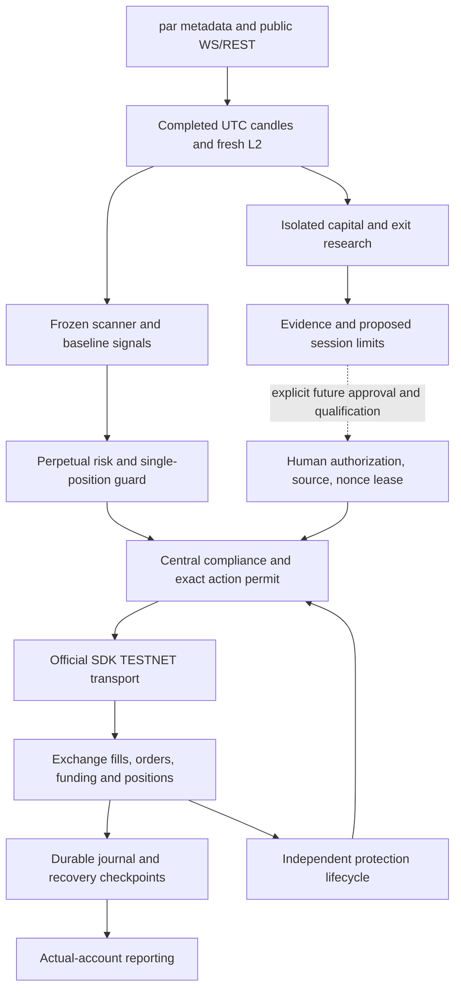

# Architecture audit before new code — 16 October 2026

Source baseline: `abc36e4a6eb6b61994b3bdc22ce05700e965afe44be697f6a0345e8c5f98f8c0`. The previous 2385-test receipt and original BUY/SELL proofs are preserved in baseline_preservation.json. All existing source and config hashes are recorded, and read-only SQLite backups preserve the journal and nonce state.

| Component | Classification | Existing implementation and evidence limits |
|---|---|---|
| Frozen indicators and signal state | **VERIFIED** | `signal_brain.py; frozen_strategy.py; crypto_strategy_state.py` — Formula/state parity and offline tests; no profitability certification |
| Dynamic par metadata and precision | **VERIFIED** | `exchange/hyperliquid_client.py; base_exchange.py` — Actual par BTC execution plus runtime precision tests; other markets require fresh qualification |
| Market scanner and explanations | **PRESENT BUT UNVERIFIED** | `market_regime_scanner.py; market_snapshot.py` — Frozen UTC, 0.40% ATR, 15 bps, 300-bar, Top-3; strategy edge not established |
| WS/REST and candle recovery | **VERIFIED** | `market_stream.py; exchange/hyperliquid_market_data.py; feed_transport.py; candle_availability.py` — Observed public collection and offline recovery; connection loss remains possible |
| Completed candles and warmup | **VERIFIED** | `candle_normalizer.py; exchange/market_health.py; candle_audit.py` — UTC completion and no OHLC-derived fill conventions |
| Actual account and collateral truth | **VERIFIED** | `exchange/hyperliquid_account.py; hyperliquid_reconciliation.py; live_recovery.py` — Two actual BTC fills, actual fees/funding and authoritative flat readbacks; latest read must be refreshed |
| Nonce and signer locks | **VERIFIED** | `exchange/execution_safety.py; single_position_guard.py` — Actual durable nonce and local owner exclusion; cannot certify remote-host exclusivity |
| Official SDK and central signed guards | **VERIFIED** | `exchange/sdk_transport.py; exchange_rules.py; compliance_guard.py` — SDK 0.24.0 and one approved LONG round trip; no new session authority |
| LONG entry and reduce-only exit | **VERIFIED** | `exchange/emergency_qualification.py; exit_recovery.py` — Actual BUY 62755970305, SELL 62805581662; +0.050512 TEST USDPR |
| UNKNOWN historical certificate repair | **VERIFIED** | `exchange/qualification_intent_recovery.py; qualification_protection.py` — Original UNKNOWN and immutable nontransmission certificate retained; unrelated uncertainty blocked |
| Generic SHORT open/cover | **PRESENT BUT UNVERIFIED** | `exchange/hyperliquid_execution.py; live_execution_session.py` — Offline negative-quantity and reduce-only BUY paths; no genuine SHORT cycle |
| Native catastrophic protection | **PRESENT BUT UNVERIFIED** | `exchange/position_protection.py; qualification_protection.py; protective_orders.py` — Extensive offline lifecycle tests; no actual protection acceptance/trigger/cleanup proof |
| Large unattended execution | **BLOCKED** | `configs/reliability_policy.json; exchange/live_runtime.py` — Protection disabled/unverified, no current scoped authorization; PAPER/false remains required |
| Existing risk and portfolio sizing | **PRESENT BUT UNVERIFIED** | `risk/portfolio_risk.py; position_sizer.py; exposure_manager.py; liquidation_guard.py` — One position, two daily setups, 10% BBO, baseline daily loss 1%; proposed 2% is not permission to relax it |
| L2 capital matrix 1k to 50k | **MISSING** | `new isolated development scope` — Need both-side route-preserving capacity, risk, fees, margin and tail tests |
| Six fee-aware exit comparisons | **MISSING** | `new isolated research scope` — Frozen production exits remain unchanged; need prespecified OOS research |
| Multi-timeframe research veto | **MISSING** | `new isolated research scope` — Completed aligned higher-timeframe features; never rewrite baseline signal formulas |
| Explicit bounded daily session mandate | **MISSING** | `new isolated development scope` — Need scope, budgets, direction proof, expiry, source, attempts and durable state; existing general LIVE builder is locked |
| Single-position lifecycle and recovery | **VERIFIED** | `exchange/order_lifecycle.py; startup_recovery.py; live_execution_session.py` — Generic offline plus one actual round trip; unattended multi-trade readiness unverified |
| Crash checkpoints and clean shutdown | **PRESENT BUT UNVERIFIED** | `exchange/startup_recovery.py; execution_journal.py` — Integrity checks work; previous bounded worker finished/revoked without setting certified clean flag |
| Research provenance and walk-forward | **VERIFIED** | `research_intelligence/evidence.py; splits.py; campaign.py; research_lab/forward_lab.py` — Immutable offline data/holdout machinery; broad representative labeled sample still insufficient |
| Daily operator report | **PRESENT BUT UNVERIFIED** | `live_session_results.py; session_results.py` — Existing reports need capital/direction/protection readiness surface |
| Full source-bound release | **VERIFIED** | `docs/profit_exit_guard_repair_2026-10-15/regression_release` — 2385 passing on abc36e4a...; any new code requires new receipt |
| Competition authorization | **BLOCKED** | `organizer-controlled rules and whitelist` — Public docs can be checked; individual whitelist and October 18 reset require organizer evidence |

## Minimal implementation scope

Add isolated deterministic capital allocation, prespecified exit-policy/L2 stress research, bounded daily-session lifecycle/gates and a public observation/report runner. Reuse the frozen scanner, Decimal metadata, book parsing, SDK, existing risk, accounting, recovery and protection tests. Add no key access or order capability to the public observation runner. Preserve every existing source/config file unless a demonstrated integration defect requires a narrow change. No actual stop or SHORT claim can be earned by offline fixtures.
