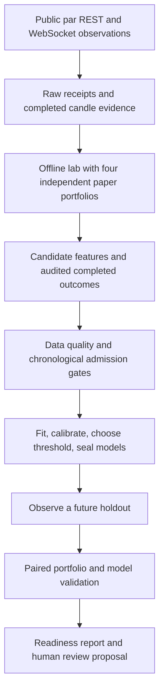

# Team Anchorium — working through the six research readiness flags

Date: 4 October 2026. This work follows the frozen strategy and PAPER-only migration rules.

## 1. What has been completed

There is now a working path from public market observations to independent paper portfolios, audited trade labels, model training, a sealed future holdout, and an evidence-based readiness report.

The strategy, scanner policy, production execution, and risk source files remain unchanged. A research proposal cannot enable exchange orders. The six flags remain evidence gates: implementing their machinery does not establish profitable results.

The current configuration stays:

```ini
EXECUTION_MODE=PAPER
ALLOW_LIVE_ORDERS=false
```

The fresh public observations still contain no completed eligible trades. Consequently, no genuine model was trained, no genuine holdout was completed, and no promotion was recommended.

## 2. The six flags in plain language

| Flag | What it means | Evidence required |
|---|---|---|
| SESSION_ANCHOR_VALIDATED | A documented alternative VWAP reference improves the measured paper results. | A sealed future comparison, enough completed trades and complete matched days, positive after-cost difference, controlled drawdown, and cost stress. |
| ML_DATA_READY | We have enough trustworthy examples for every model domain. | Adequate unique, completed candidate outcomes, dates, positive and negative results, directions, market coverage, and fill/cost audits. |
| ML_MODEL_VALIDATED | A numerical filter works on observations it never used for fitting. | Held-out classification/calibration plus independent portfolio comparisons, including risk and costs. |
| HOLDOUT_COMPLETE | The planned future evaluation has finished and has enough usable evidence. | Models sealed first; complete observation coverage; adequate outcomes; no unresolved gaps, funding, or portfolio faults. |
| PROMOTION_RECOMMENDED | The research supports a proposal for human review. | The relevant anchor, model, holdout, risk, and cost comparisons pass. It grants no trading permission. |
| PRODUCTION_CHANGED | The deployed strategy or execution behavior was changed. | This remains FALSE throughout this research task. |

The report also retains BASELINE_PRESERVED and VWAP_RESEARCH_READY. Those describe strategy protection and the implemented engineering mechanisms.

## 3. The new structure



The pieces have separate responsibilities:

| File | Responsibility |
|---|---|
| scripts/collect_research_evidence.py | Bounded public recorder, request budgets, streaming observations and completed-candle REST reads. |
| research_intelligence/evidence.py | File integrity, chronology, raw receipt matching and completion checks. |
| research_lab/forward_lab.py | Four isolated local portfolios using existing scanner, management, risk and paper accounting kernels. |
| research_intelligence/campaign.py | Audited data admission, earlier fitting and future model seals. |
| research_intelligence/readiness.py | Evidence-based flags, paired day comparisons and remaining-data reports. |
| scripts/run_research_readiness.py | The replay, status, seal and holdout commands. |
| algo-trading-bot/test_research_readiness.py | Synthetic engineering tests for these boundaries. |

The pure research package retains its existing prohibition on importing the bot or exchange client. Portfolio replay lives in a separate offline laboratory. Production does not import either experimental path.

## 4. Public evidence collection

The recorder selects Hyperliquid testnet and the par DEX. Runtime metadata determines the market specifications. It reads public market data and never asks for a wallet secret, account action, or signed order. The venue guide documents these endpoints, prefixed market names, runtime specifications and USDPR collateral. [Official participant guide](https://perpetual-alpha26.github.io/docs/#venue).

Each receipt records the raw response and its observation time. Each record points to the previous record's hash. A completion file seals the count and final root, making a removed tail or changed line detectable.

These are local integrity checks. They do not constitute exchange-signed proof of authenticity. The original raw responses remain necessary for independent inspection.

The collector samples once per second and keeps the original 300-second scan cadence. A separate 3,000-bar cache supplies enough prior history for a documented daily anchor. That cache does not change the strategy's 300-bar scanner policy.

After its initial history, the collector writes new or corrected candle rows rather than repeating the whole history every minute. It retains original source and receipt timestamps.

A WebSocket candle update can arrive before the candle ends. Such an update does not prove the final OHLCV. The recorder therefore reads completed candles through REST at minute boundaries. It waits for enough request budget for the market-wide batch, and preserves read failures as health evidence. It does not insert fabricated candles into missing minutes.

The public API and streaming formats are described in the [Hyperliquid info documentation](https://hyperliquid.gitbook.io/hyperliquid-docs/for-developers/api/info-endpoint) and [subscription documentation](https://hyperliquid.gitbook.io/hyperliquid-docs/for-developers/api/websocket/subscriptions).

## 5. Four independent paper portfolios

| Arm | VWAP reference | Candidate filter |
|---|---|---|
| UTC_NO_ML | Frozen UTC baseline | Existing deterministic admission |
| SESSION_NO_ML | Configured research anchor; explicit UTC controls elsewhere | Existing deterministic admission |
| UTC_ML | Frozen UTC baseline | Sealed numerical model veto |
| SESSION_ML | Configured research anchor; explicit UTC controls elsewhere | Sealed numerical model veto |

Each arm has its own starting paper USDPR pool, positions, margin, fees, funding, cooldowns, setup count, orders, fills, state and equity. It cannot borrow another arm's successful fills or remove losing trades after observing them.

All arms see the same saved observations. The file-backed market accepts only recorded metadata reads. It cannot open a socket or query an account. Local fills use fresh recorded BBO prices and displayed quantities through the existing paper executor.

The ML filter runs after unchanged perpetual-risk approval. A baseline risk denial remains a denial. A model veto does not change direction, size, stops or targets, and never suppresses protective management or exits. Missing models or required features block the ML arm's entries. The deterministic arms continue their normal evaluation.

A flat ML arm without a model is reported as ML_UNAVAILABLE and excluded from benefit comparisons.

## 6. Preserving the exact brain input

One subtle implementation issue mattered: passing a longer history into the entire brain could change its anti-spam cursor.

The lab now preserves the original scanner request window for the baseline and every alternative. EMA, ATR, volume averages, warmup and anti-spam logic receive that original window.

Only the two existing research VWAP assignments consult additional receipt-verified history. VWAP and its slope are calculated over that history and aligned back to the original input rows.

The production brain is never patched. The research AST copy remains hash-verified. A parity test compares the reference lab scanner with the existing scanner and checks identical non-VWAP indicator columns for a different anchor.

The documented SP500, EWY and EWJ references remain research hypotheses. Unconfigured assets retain UTC controls. Korea/Japan reference boundaries currently coincide with UTC midnight; they are not counted as independent boundary improvements.

## 7. Candidate labels and honest accounting

A dataset row requires an actual deterministic setup. A market check with no signal is not a training example.

A completed outcome is exported only when the lab can link:

1. The original candidate and its decision-time feature evidence.
2. Its local entry fill IDs.
3. All local exit fill IDs, including partial exits.
4. Balanced entry and exit quantities.
5. Matching portfolio ledger entries.
6. Fees and funding within the holding period.
7. The quote used for each fill.
8. Reconciled trade net P&L and an audit hash.

Prices are the observed bid or ask. A candle high, low or close cannot create a fill.

The primary label remains positive net outcome after costs. Rejected and unfinished candidates have no pretend results. Unknown management/funding intervals prevent outcome labels. A gap or reconnect cannot quietly produce a clean validation claim.

The base paper fill assumption has no additional price impact beyond the displayed BBO. Bid/ask spread is already inside the execution prices and is not deducted twice. Extra friction is assessed separately.

The recorded fee policy remains the existing example assumption: 0.09% taker and 0.03% maker. The official venue guide lists those undiscounted base-tier rates; actual account charges still require reported fills and account-specific verification. [Official fee and funding mechanics](https://perpetual-alpha26.github.io/docs/#venue-mechanics).

Funding in this lab remains the existing paper boundary estimate from observed oracle/rate snapshots, with explicit provenance. It is not a reported wallet payment.

## 8. Model admission, fitting and sealing

The main sample requirements stay 500 labeled candidates, 20 labeled dates, at least 100 positive and 100 strictly negative outcomes, and at least 20 examples in each direction.

The cross-asset UTC model requires three markets. A declared single-asset session model is evaluated within its one-asset domain. This is an explicit domain correction: a single SP500 model cannot contain three distinct markets. The 500-row, date, class, direction and partition requirements remain.

Identical UTC controls from the session arm are excluded from the UTC training sample. Repeated labs/replays cannot increase sample counts.

Fitting requires at least 200 training, 50 calibration and 50 threshold-validation rows, with both classes and the existing class floors in each partition. One-hour boundary purging also removes outcomes that run into the next partition.

Transforms fit on earlier training rows. Probability calibration uses the next segment. Threshold selection uses the following segment. The future holdout is absent from every fitting operation.

The existing logistic and shallow-tree implementations are retained. This campaign chooses the logistic family in advance for prospective portfolio evaluation; the tree remains a diagnostic artifact. There is no attempt to pick the best family after seeing holdout results.

The seal records source hashes, data hashes, parameters, model versions, feature schema, calibration, threshold, split boundaries, future evaluation end and earlier admission evidence. Source hashes include the recorder, offline lab and reused management/accounting kernels.

Insufficient data produces training_readiness.json and MORE_DATA_REQUIRED. It produces no fake model or sealed campaign.

## 9. Future holdout and promotion review

The seal must precede the future holdout. Already-observed future rows are refused.

The holdout command verifies the campaign, model domains, source code, assumptions, capture creation time and sealed time boundaries. It claims the evaluation in a local holdout ledger before replaying portfolios.

Historical bars may warm up the indicators, but they cannot establish past trades or past quote availability. All four holdout portfolios start from the same declared hypothetical collateral and flat state.

The evaluation requires a finished window with full start/end coverage, adequate audited holdout labels, both classes, and complete portfolio evidence. Partial observations cannot satisfy HOLDOUT_COMPLETE.

Model checks include held-out ROC AUC above 0.5, Brier score better than the sealed training-prior predictor, and adequate accepted candidates. Financial checks use independently executed portfolio paths.

Portfolio comparisons use complete matched UTC days, omit first/final partial days, and compare daily equity changes. The prespecified day-block bootstrap reports a descriptive 95% interval. A positive lower bound is required by the review gate, alongside at least 100 completed trades per compared arm and drawdown no worse than the reference.

The extra-friction check applies double fees and another 10 bps to the observed fill notionals. This is an analytical stress calculation on the existing path. It does not rerun altered margin, sizes, stops or fills, and is labelled accordingly.

Passing the gates supports a research review proposal. It still does not permit an exchange order. Larger statistical studies, regime stability, executable testnet verification and the established human activation process remain separate requirements.

## 10. What the genuine public samples showed

The first fresh REST probe reached all ten par markets. Nine market diagnostics reported stale completed candles.

BTC was fresh, but its ATR fraction was approximately 0.00028636: about 0.0286%. The preserved scanner floor is 0.004: 0.40%. BTC also had no deterministic signal at that observation.

The bot therefore produced no watchlist and no fills. Its hypothetical 20,000 USDPR ledger stayed flat.

Additional bounded captures tested the receipt recorder, independent replay, completed-candle rules, and request-budget behavior. They are engineering observations, not independent long-term strategy studies. The final evidence numbers and current diagnostics are saved in [the validation evidence](</Users/adesh/Autonomous Trading Bot - Crypto /docs/research_readiness_validation_2026-10-04.json>) and [the readiness report](</Users/adesh/Autonomous Trading Bot - Crypto /docs/research_readiness_release_2026-10-04/readiness.md>).

The final 75-second recording contained 1,018 records: 45 public REST receipts, 906 public stream messages, 64 portfolio observation frames and three lifecycle events. Startup and history recovery consumed part of the bounded run; the valued observation path covered roughly 64 seconds. Initial receipt-backed history contained 29,624 completed bars across the ten markets. Those bars do not become 29,624 candidate labels.

The final scan differed from the earlier probe: eight markets had stale completed candles. BRENT and SP500 had fresh candles, but ATR was approximately 0.00698% and 0.01998%, respectively, and both spreads exceeded the unchanged limit. The final watchlist remained empty. This changing diagnostic evidence is why each result retains its timestamps.

No completed eligible candidate outcomes were available in these samples. A flat short run provides no evidence of alpha, a superior anchor or a validated ML model.

The supplied tests also contain synthetic profitable and losing fixtures. They prove code behavior and remain separate from genuine results.

## 11. The collection constraint and hackathon priorities

The current reference portfolio allows at most two new setups each day.

Even with every allowed setup completing, 500 unique executed reference trades would require at least 250 days. Class balance, asset coverage, missed opportunities and separate model domains can make that longer.

A few weeks of this paper portfolio cannot meet the current training gate on its own. Duplicating replays, combining identical arms, training on random candle labels, or reducing risk protections would not resolve the evidence requirement.

For the hackathon, the actionable priorities are:

1. Diagnose stale competition-market data with the saved request, candle and book evidence.
2. Keep public recording running in explicitly bounded sessions and inspect health/coverage.
3. Demonstrate the deterministic migration with reproducible logs, strategy parity, risk control and honest results.
4. Keep ML optional until genuine data admission and future evaluation pass.
5. Prepare a concise code walkthrough, observed-result table and reproducibility commands.
6. Treat wallet funding/configuration/manual verification as the separate existing readiness process.

This gives the team a technically credible system and a defensible submission. It does not guarantee a competition rank.

## 12. Commands you and Parth can follow

Run these from the cloned repository with its existing virtual environment. Every output directory must be new.

### A. Collect one bounded hour

```sh
.venv/bin/python scripts/collect_research_evidence.py \
  --duration-seconds 3600 \
  --output algo-trading-bot/data/crypto-research/anchorium-hour-01
```

Keep the original duration, observation and scan choices recorded. The tool exits after its bounded duration. No unattended recorder or recurring automation was left running by this task.

### B. Replay the four paper arms

```sh
.venv/bin/python scripts/run_research_readiness.py replay \
  --capture algo-trading-bot/data/crypto-research/anchorium-hour-01 \
  --output algo-trading-bot/data/crypto-research/anchorium-hour-01-lab
```

Keep evidence.jsonl, capture_manifest.json and capture_completion.json with the lab outputs. The labels are meaningful only with their source evidence.

### C. Generate the readiness report

```sh
.venv/bin/python scripts/run_research_readiness.py status \
  --lab algo-trading-bot/data/crypto-research/anchorium-hour-01-lab \
  --output algo-trading-bot/data/crypto-research/anchorium-hour-01-readiness
```

Use repeated --lab arguments for independent training runs with matching assumptions. Duplicate candidate evidence is rejected. Separate captures reset their hypothetical portfolios; they must not be presented as one continuous equity path.

### D. Prepare genuine earlier data and future dates

After data admission is possible, write a split JSON containing these fields:

```json
{
  "validation_start_ms": "2027-01-01T00:00:00Z",
  "validation_tune_start_ms": "2027-02-01T00:00:00Z",
  "holdout_start_ms": "2027-03-01T00:00:00Z",
  "holdout_end_ms": "2027-04-01T00:00:00Z",
  "embargo_ms": 3600000
}
```

These are schema examples, not an approved experiment schedule. Replace them with dates supported by your actual earlier dataset and a genuinely future holdout. Dates require explicit timezone information. Integer milliseconds are also accepted.

### E. Fit and seal

```sh
.venv/bin/python scripts/run_research_readiness.py seal \
  --lab algo-trading-bot/data/crypto-research/anchorium-training-lab \
  --split-config research/my-approved-future-split.json \
  --output algo-trading-bot/data/crypto-research/anchorium-campaign-01
```

Read training_readiness.json. If it says MORE_DATA_REQUIRED, collect further valid evidence. There is no model to use until the seal exists.

### F. Record and evaluate the future window

Start a new capture after the seal and retain continuous observations for the whole planned window. Sampling interruptions/reconnects are exposed and can invalidate the window. Allow ample storage for raw data.

After the window ends:

```sh
.venv/bin/python scripts/run_research_readiness.py holdout \
  --campaign algo-trading-bot/data/crypto-research/anchorium-campaign-01 \
  --capture algo-trading-bot/data/crypto-research/anchorium-future-window \
  --output algo-trading-bot/data/crypto-research/anchorium-holdout-01
```

The holdout command cannot refit or tune a model. Review its evaluation/readiness.md and the four portfolio traces.

## 13. Validation and current limits

The pre-change baseline had 1,006 passing tests. The final regression passed all 1,054 tests, including 48 added checks, with zero failures/errors/skips. All 152 pre-existing Python files remained byte-identical. The protected source hashes, public capture roots and current flags are recorded in [the consolidated validation file](</Users/adesh/Autonomous Trading Bot - Crypto /docs/research_readiness_validation_2026-10-04.json>).

The new tests cover public-read boundaries, receipt matching, future timestamps, tampering/truncation, independent arm behavior, original brain-window parity, local entry/exit accounting, rejected/missing ML behavior, gaps/reconnects, duplicate evidence, chronological sealing, source/model edits, and paired complete-day comparisons.

Strategy-freeze checks cover one entire protected file, eight methods and 32 parameters. Phase 0 checks continue to enforce the venue, PAPER mode, disabled Angel One and disabled exchange orders.

There are material limits:

- The current genuine sample has zero training labels and zero completed validation trades.
- The final public capture is short; it does not prove long-running operational reliability.
- Raw receipts use local collection provenance, not exchange cryptographic attestation.
- Marks and drawdown are sampled; they do not capture every intratick extreme.
- Additional friction stress is analytical rather than a changed execution-path replay.
- A day-block interval is a descriptive admission check, not conclusive statistical proof.
- The capture can run for at most 90 days per invocation; the present CLI requires one continuous capture for a campaign holdout. Independent restarted runs are never quietly stitched into one portfolio path. The offline lab retains observation series in memory, so a long study requires adequate memory and storage; this short probe does not validate deployment at that scale.
- Long captures can consume substantial storage; initial history is large even though later candle updates are incremental.
- Initial setup/reconnect and unavailable final candles remain explicit health events.
- No wallet was configured, no account administration was attempted, and no exchange order was submitted.

The prototype therefore completes the collection, replay, audit and validation mechanisms that can be tested now. Scientific validation remains dependent on adequate genuine observations.

## 14. Current result and terms used in the report

```ini
BASELINE_PRESERVED         = TRUE
VWAP_RESEARCH_READY        = TRUE
SESSION_ANCHOR_VALIDATED   = FALSE
ML_DATA_READY              = FALSE
ML_MODEL_VALIDATED         = FALSE
HOLDOUT_COMPLETE           = FALSE
PROMOTION_RECOMMENDED      = FALSE
PRODUCTION_CHANGED        = FALSE
```

The first five requested FALSE values reflect missing scientific evidence. PRODUCTION_CHANGED remains FALSE because the research was intentionally isolated.

| Term | Plain-language explanation |
|---|---|
| Candidate | A LONG or SHORT setup actually produced by the frozen strategy. |
| BBO | The best bid and best offer visible in the recorded order book. |
| Label | The measured completed-trade outcome used to teach the numerical model. |
| Calibration | Checking that predicted probabilities agree with observed success frequencies. |
| Holdout | Later data kept outside fitting, calibration and threshold selection. |
| Purge/embargo | Removing rows whose decisions or outcomes reach too close to the next time segment. |
| Drawdown | The largest measured fall in equity from an earlier peak. |
| Mark equity | Collateral plus open-position profit/loss valued using the exchange mark. |
| Cost stress | Testing whether added fees/friction would erase the observed result. |
| Promotion | A proposal to adopt a tested research change; it is separate from activation. |
