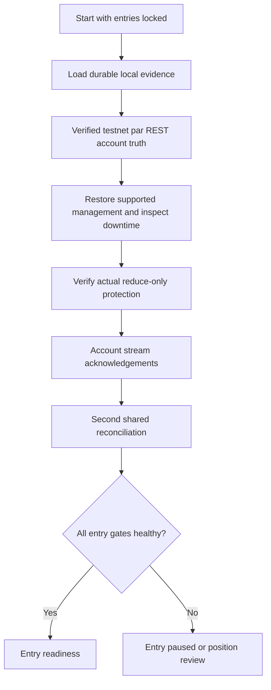

# Team Anchorium — Restart recovery and opportunity diagnostics

**Date:** 3 October 2026 · **Network:** Hyperliquid Testnet · **DEX:** `par`  
**Scope:** Production reliability and observational research  
**Defaults:** `EXECUTION_MODE=PAPER`, `ALLOW_LIVE_ORDERS=false`

The project now has a crash-safe startup coordinator and an opportunity evidence system. The validated signal brain and management rules remain unchanged. Real exchange submissions during this task: **zero**. Production catastrophic protection remains disabled, with its distance/slippage still unset. This report distinguishes offline engineering proof from funded-account readiness and actual trading performance.

## 1. Audit

The verified repository is the Crypto clone, on `perpetual-alpha-migration`. Its pre-task HEAD was `f79dd77c1a2ff5c2acc58c21d1196a24e2713136`. The pre-task checkout was clean. Existing reliability components were retained. The initial audit records the working-file hashes alongside Git HEAD. The original NSE repository was untouched.

Before editing, strategy freeze passed for one file, eight methods and 32 parameters. All 12 Phase 0 checks passed. The full existing baseline was **844 tests, zero failures**.

Existing persistence included durable order intents/CLOIDs, account fills/funding, management records and risk controls in `ExecutionJournal`. Existing recovery already adopted exchange quantities, deduplicated executions, rejected unexplained deltas and retained actual fees/funding. Account streams already requested REST recovery. The scanner already evaluated verified runtime markets and produced individual rejection reasons. PAPER/REPLAY already exported candidates, orders, fills and provenance.

| Gap | Consequence | Resolution |
|---|---|---|
| No single startup state machine | Entry permission could be difficult to distinguish from an accounting checkpoint | One coordinator and executor-level startup gates |
| Separate account/management saves | A crash could interrupt a combined checkpoint | Same-database transactional, checksummed snapshots with previous copy |
| No clean shutdown marker | A reboot/kill was difficult to distinguish from a completed shutdown | Persistent per-run clean/unclean/unknown evidence |
| No explicit exposed-downtime review | Missed management bars could be ignored or wrongly reconstructed | Contiguous observed candle backfill, unchanged shadow management and review barriers |
| History saturation only raised a page-limit error | Complete evidence could remain unavailable despite divisible time windows | Bounded recursive time splitting; indivisible saturated timestamps remain paused |
| Sparse rejection events, no complete aggregate funnel | Zero trades could invite guesses about ATR or spread | Every-market traces, first/all observed failures, admission survivors and distributions |
| No isolated `par` scanner research | Experiments could be confused with production policy | Immutable variants and saved-observation-only evaluation |

The work preserves scanner ATR **0.40%**, maximum spread **15 bps**, required history **300 bars** and **Top-3**. Their effect can now be measured; none was relaxed.

## 2. Files modified

These responsibilities describe this task's changes, compared with the recorded working-file hashes. Previously implemented reliability components are retained rather than attributed to this phase.

| File | Responsibility |
|---|---|
| [AGENTS.md](</Users/adesh/Autonomous Trading Bot - Crypto /AGENTS.md>) | Records this directive and the unchanged strategy/threshold/activation boundaries. |
| [README.md](</Users/adesh/Autonomous Trading Bot - Crypto /README.md>) | Adds restart, diagnostic reports and safe research usage. |
| [algo-trading-bot/crypto_paper_bot.py](</Users/adesh/Autonomous Trading Bot - Crypto /algo-trading-bot/crypto_paper_bot.py>) | Observes the existing PAPER/REPLAY decisions, fills and completion without adding replay clock reads. |
| [algo-trading-bot/exchange/base_exchange.py](</Users/adesh/Autonomous Trading Bot - Crypto /algo-trading-bot/exchange/base_exchange.py>) | Carries reported position leverage without estimating it. |
| [algo-trading-bot/exchange/execution_journal.py](</Users/adesh/Autonomous Trading Bot - Crypto /algo-trading-bot/exchange/execution_journal.py>) | Combined transactional snapshots, checksums, previous checkpoint and persistent opportunity traces. |
| [algo-trading-bot/exchange/hyperliquid_account.py](</Users/adesh/Autonomous Trading Bot - Crypto /algo-trading-bot/exchange/hyperliquid_account.py>) | Validates leverage and splits saturated fill/funding windows with a bounded backfill budget. |
| [algo-trading-bot/exchange/hyperliquid_execution.py](</Users/adesh/Autonomous Trading Bot - Crypto /algo-trading-bot/exchange/hyperliquid_execution.py>) | Startup/public-feed lock applies before entry reservation and again immediately before signing. |
| [algo-trading-bot/exchange/hyperliquid_reconciliation.py](</Users/adesh/Autonomous Trading Bot - Crypto /algo-trading-bot/exchange/hyperliquid_reconciliation.py>) | Uses complete bounded history reads for the same authoritative reconciliation core. |
| [algo-trading-bot/exchange/live_account_stream.py](</Users/adesh/Autonomous Trading Bot - Crypto /algo-trading-bot/exchange/live_account_stream.py>) | Revokes startup readiness on loss/events and invokes the same coordinator for post-stream reconciliation. |
| [algo-trading-bot/exchange/live_recovery.py](</Users/adesh/Autonomous Trading Bot - Crypto /algo-trading-bot/exchange/live_recovery.py>) | Loads/validates durable evidence, preserves management and writes combined checkpoints; supports bounded history expansion. |
| [algo-trading-bot/exchange/live_runtime.py](</Users/adesh/Autonomous Trading Bot - Crypto /algo-trading-bot/exchange/live_runtime.py>) | Graceful Ctrl-C/SIGTERM handling, separate unexpected failure marker and safe paused management loop. |
| [algo-trading-bot/live_execution_session.py](</Users/adesh/Autonomous Trading Bot - Crypto /algo-trading-bot/live_execution_session.py>) | Restores controls, candidate/exit/flip state; coordinates startup; preserves actual-fill idempotence and feeds diagnostics. |
| [algo-trading-bot/live_session_results.py](</Users/adesh/Autonomous Trading Bot - Crypto /algo-trading-bot/live_session_results.py>) | Exports startup recovery and opportunity reports alongside actual-account results. |
| [algo-trading-bot/market_regime_scanner.py](</Users/adesh/Autonomous Trading Bot - Crypto /algo-trading-bot/market_regime_scanner.py>) | Adds read-only last-candle/lag/rank/brain evidence and whole-context-failure traces without changing admission or ranking. |
| [algo-trading-bot/risk/portfolio_risk.py](</Users/adesh/Autonomous Trading Bot - Crypto /algo-trading-bot/risk/portfolio_risk.py>) | Copies computed cost evidence and friction outcomes; keeps risk decisions and thresholds unchanged. |
| [algo-trading-bot/session_results.py](</Users/adesh/Autonomous Trading Bot - Crypto /algo-trading-bot/session_results.py>) | Writes funnel and read-only startup reports alongside existing PAPER/REPLAY results. |
| [scripts/check_live_readiness.py](</Users/adesh/Autonomous Trading Bot - Crypto /scripts/check_live_readiness.py>) | Adds an explicitly read-only startup status; never assumes flat or authorizes execution. |

The [legacy dependency inventory CSV](</Users/adesh/Autonomous Trading Bot - Crypto /docs/legacy_dependency_inventory.csv>) and [inventory JSON](</Users/adesh/Autonomous Trading Bot - Crypto /docs/legacy_dependency_inventory.json>) are also refreshed to keep occurrence locations accurate. Neither the strategy-freeze manifest nor a protected strategy source was edited.

## 3. Files created

| File | Responsibility |
|---|---|
| [algo-trading-bot/exchange/startup_recovery.py](</Users/adesh/Autonomous Trading Bot - Crypto /algo-trading-bot/exchange/startup_recovery.py>) | Startup states, shared reconciliation barrier, shadow downtime review, lifecycle markers and reports. |
| [algo-trading-bot/brain_observation.py](</Users/adesh/Autonomous Trading Bot - Crypto /algo-trading-bot/brain_observation.py>) | Passive final-bar observations from the frozen function; respects an existing debugger. |
| [algo-trading-bot/opportunity_funnel.py](</Users/adesh/Autonomous Trading Bot - Crypto /algo-trading-bot/opportunity_funnel.py>) | Central rejection taxonomy, idempotent stages, aggregate statistics and exports. |
| [algo-trading-bot/counterfactual_research.py](</Users/adesh/Autonomous Trading Bot - Crypto /algo-trading-bot/counterfactual_research.py>) | Isolated immutable research variants, causal admission, chronological holdout and recorded cost/outcome comparison. |
| [algo-trading-bot/test_restart_opportunity_diagnostics.py](</Users/adesh/Autonomous Trading Bot - Crypto /algo-trading-bot/test_restart_opportunity_diagnostics.py>) | New synthetic recovery, funnel, research and real process-kill tests. |
| [algo-trading-bot/test_fixtures/restart_crash_worker.py](</Users/adesh/Autonomous Trading Bot - Crypto /algo-trading-bot/test_fixtures/restart_crash_worker.py>) | Ephemeral offline SDK subprocess killed at actual owner lifecycle points; the synthetic exchange survives separately. |
| [scripts/research_crypto_opportunities.py](</Users/adesh/Autonomous Trading Bot - Crypto /scripts/research_crypto_opportunities.py>) | Offline saved-observation research CLI; no trading runtime construction. |
| [docs/restart_diagnostics_initial_audit_2026-10-03.json](</Users/adesh/Autonomous Trading Bot - Crypto /docs/restart_diagnostics_initial_audit_2026-10-03.json>) | Pre-edit source hashes, protected manifest, repository identity and pre-existing dirty work. |
| [docs/restart_diagnostics_focused_2026-10-03.xml](</Users/adesh/Autonomous Trading Bot - Crypto /docs/restart_diagnostics_focused_2026-10-03.xml>) | Focused regression evidence. |
| [docs/restart_diagnostics_regression_2026-10-03.xml](</Users/adesh/Autonomous Trading Bot - Crypto /docs/restart_diagnostics_regression_2026-10-03.xml>) | Final full-suite evidence. |
| [docs/restart_diagnostics_strategy_parity_2026-10-03.json](</Users/adesh/Autonomous Trading Bot - Crypto /docs/restart_diagnostics_strategy_parity_2026-10-03.json>) | Pre-task/current indicator and signal equality. |
| [docs/restart_diagnostics_validation_2026-10-03.json](</Users/adesh/Autonomous Trading Bot - Crypto /docs/restart_diagnostics_validation_2026-10-03.json>) | Consolidated machine-readable results, changed-file hashes, scope and readiness. |
| [docs/restart_opportunity_report_2026-10-03.md](</Users/adesh/Autonomous Trading Bot - Crypto /docs/restart_opportunity_report_2026-10-03.md>) | This 12-section plain-language engineering handover. |

The evidence directory `docs/restart_diagnostics_observations_2026-10-03/` contains the full session/daily/market/hour/weekday reports, distributions, staleness and Top-3 analysis, opportunity traces, replay validation and counterfactual JSON/text. These are derived from a genuine saved public tape, not fabricated market observations. The original tape and historical reports are retained.

## 4. Restart recovery

The startup states are `BOOTING`, `ACCOUNT_NOT_CONFIGURED`, `READ_ONLY_READY`, `RECOVERY_REQUIRED`, `RECOVERING`, `RECONCILING`, `POSITION_REVIEW`, `ENTRY_PAUSED`, `READY` and `FAILED_SAFE`. Read-only reporting never grants execution permission.



`AccountReconciler` is the existing `LiveAccountRecovery` service. Startup, account-stream reconnect, ambiguous actions and verification all use that same authoritative core. The coordinator adds lifecycle and entry permission; it does not maintain a second account ledger.

The checkpoint lives in the existing SQLite journal. WAL and FULL synchronization support crash-safe transactions. A complete snapshot includes schema/session/account/venue identity, mode, Git and working-source identity, checkpoint time, account quantities, fill/funding evidence and IDs, reconciliation window, management records, candidates, pending entry/exit/flip context, all known intents/OIDs/CLOIDs, candle cursors and risk controls. Stops, targets, entry ATR, breakeven state, daily bias, cooldown and observed held-bar counters are preserved. No key, seed or signer is serialized.

Each snapshot has a checksum, and two complete snapshots are retained. Account evidence, management and lifecycle metadata are committed together. A corrupt newest snapshot raises a persistent review condition; a previous copy is retained for investigation, not silently treated as a healthy restart. Legacy journal checkpoints remain readable. Unsupported management schemas or malformed evidence block entries while account reads still discover actual exposure.

The account session ID is a stable journal identity; each process boot has a separate run ID. Supplying a different account/session to an existing journal remains an error rather than resetting its state.

Exchange positions are authoritative. Local flat plus exchange exposure is adopted and reviewed. Local exposure plus exchange flat requires exit evidence. Quantity differences require reported fills and supported management reconstruction. Direction or entry-price mismatches pause entries. Position reads retain signed quantity, average entry, reported leverage, liquidation price, margin and unrealized P&L where supplied. Missing fields are not estimated.

Open orders are classified using durable IDs as ENTRY, STRATEGY_EXIT, CATASTROPHIC_STOP or UNKNOWN. No take-profit order is created by this phase. Unrecognized orders require review and are not canceled automatically. Account-wide discovery does not silently forget them.

Fill and funding reads start with an inclusive overlap around the last successful window. Exchange identities deduplicate them. Saturated pages split into smaller time windows, up to 64 requests per backfill operation. A full indivisible timestamp or exhausted backfill budget remains incomplete evidence. Unexplained position deltas can expand recovery to the original known accounting origin. Actual funding uses reported cashflows; paper funding formulas never substitute for account evidence.

Management restoration uses stored candidates, actual linked fills and verified transitions. Breakeven is retained when recorded; normal stops/targets are not reset from current prices. A pending exit survives a partial fill. A direction flip retains an explicit flat-before-opposite intent; the existing bias/cooldown and flip decision rules stay frozen.

Exposed downtime requires exact, completed one-minute candles after the last processed cursor. A shadow copy executes the SAME frozen management methods with an inert exit callback. Safe supported transitions and counters can be restored. A missed normal stop, a target touch needing executable-price review, missing candles or an unknown held cursor produces POSITION_REVIEW. No historical fill is inferred from OHLC, and wall time never increments candle counters. Existing flat-market cursor recovery still preserves cooldown and counts only observed bars.

After acknowledged account subscriptions, a second stable REST reconciliation closes the snapshot/subscription timing gap. Protection is rediscovered and verified again. The final signing gate also checks current account/public-stream health, so a later feed loss can revoke entry permission even after startup was READY.

## 5. Crash safety

A graceful shutdown completes resource shutdown and writes a clean marker. Ctrl-C and SIGTERM are handled separately from unexpected exceptions. SIGKILL cannot execute Python cleanup and leaves an unclean marker. A clean marker means the local shutdown finished; it never means the exchange account is flat.

Durable intent identity prevents a crash from authorizing duplicate transmission. Uncertain exchange results remain unresolved until CLOID/status, orders, fills and positions establish an outcome. Actual fills, rather than order response summaries, reconstruct quantities and accounting. Process restart starts locked even after a clean shutdown.

Catastrophic protection remains the previously implemented independent reduce-only layer. Restart verifies its owned identity, direction, quantity, trigger and status against actual positions. A missing/obsolete guard can be repaired only after authoritative reconciliation and the already-required approval/clock/nonce/API gates. Unsupported trigger children or unprovable outcomes remain paused. No production trigger was sent during this task.

The new tests include real SIGKILL of a subprocess at eight owner lifecycle scenarios: entry fill, ledger-before-checkpoint, checkpoint-before-manager, exit acceptance before response, partial exit, funding boundary, WebSocket reconciliation and protection creation. The synthetic exchange persists outside that killed process, letting restart recover external truth. Separate multi-table WAL interruption tests verify transaction rollback. No subprocess private key or signature is stored in those fixture files.

## 6. Opportunity funnel

The exact stage vocabulary is:

```text
TOTAL_MARKETS_SEEN → VALID_MARKET_IDENTITY → MARKET_DATA_HEALTHY
→ ENOUGH_HISTORY → LIQUIDITY_PASS → SPREAD_PASS → ATR_PASS
→ SCANNER_QUALIFIED → TOP3_SELECTED → STRATEGY_EVALUATED
→ SIGNAL_GENERATED → BIAS_PASS → ANTI_SPAM_PASS → FRICTION_PASS
→ RISK_PASS → EXECUTION_PERMISSION → ORDER_ATTEMPTED → FILLED
→ TRADE_COMPLETED
```

Every verified market-cycle gets a trace, including rejected markets and whole asset-context read failures. A trace records source, candidate, UTC day/hour/weekday, policy, measured metrics, actual scanner rank, selection, data/candle timing, signal evidence, first blocking reason and all safely observed failures. Candidate/fill/completion accounting is idempotent, including journal reload.

Statuses distinguish PASS, FAIL, NOT_REACHED and NOT_OBSERVED. Each stage reports counts, denominator and percentage. Admission survivors show the ordered narrowing funnel; independent observed condition counts are retained separately. For example, stale data can eliminate all admitted candidates even when the response contains 300 candles. That history observation is useful evidence, not permission to continue.

The actual decision order is unchanged. The first blocker follows the existing reason order and frozen permission order; all observed failures can include ATR, spread and depth together. Friction and risk remain the existing combined assessment; a check that did not run is not retroactively declared successful.

Brain diagnostics passively observe the unchanged function's final-bar locals. They do not compute alternative signals, weaken warmup or change anti-spam state. An existing debugger is respected; unavailable internals stay unobserved. The scanner already computes frozen indicators for metrics before qualification. Nonselected setups are labeled as an indicator side channel, not an executed strategy opportunity.

The centralized rejection codes cover data freshness/history/identity, scanner ATR/spread/depth/liquidity/Top-3, setup/bias/warmup/anti-spam/cooldown, combined negative edge or insufficient RR, funding/costs, risk/exposure/margin/liquidation and system/recovery/account/API gates. Raw existing reasons are retained, and unrecognized reasons are UNCLASSIFIED rather than guessed. Exact codes are listed in `funnel_summary.json` and below. A code reports a failure only when the runtime supplies supporting evidence; taxonomy membership alone is not a measured bottleneck.

```text
STALE_CANDLE
STALE_BOOK
STALE_MARK
HISTORY_GAP
INSUFFICIENT_HISTORY
INVALID_MARKET_DATA
MARKET_DATA_UNAVAILABLE
ATR_BELOW_SCANNER_FLOOR
SPREAD_TOO_WIDE
INSUFFICIENT_DEPTH
ZERO_LIQUIDITY
NOT_TOP3
NO_SETUP
BIAS_MISMATCH
WARMUP
ANTI_SPAM_LOCK
COOLDOWN
ATR_BELOW_BRAIN_FLOOR
NEGATIVE_NET_EDGE_OR_RR
FEES_TOO_HIGH
FUNDING_TOO_EXPENSIVE
SLIPPAGE_TOO_HIGH
DAILY_LOSS_LIMIT
MAX_DRAWDOWN
EXPOSURE_LIMIT
MARGIN_LIMIT
LIQUIDATION_BUFFER
POSITION_ALREADY_OPEN
ENTRY_PAUSED
RECOVERY_PENDING
RATE_LIMIT
ACCOUNT_UNREADY
UNCLASSIFIED
```


Generated files include `funnel_summary.json`, `funnel_summary.csv`, `opportunity_traces.jsonl`, `market_funnel.json`, `daily_funnel.json`, `hourly_funnel.json`, `weekday_funnel.json`, `atr_spread_distributions.json`, `staleness_diagnostics.json`, `top3_exclusions.json` and `opportunity_report.txt`. Startup exports are `startup_recovery.json` and `startup_recovery.txt`.

Saved evidence files and their purposes:

| File | Contents |
|---|---|
| [funnel_summary.json](</Users/adesh/Autonomous Trading Bot - Crypto /docs/restart_diagnostics_observations_2026-10-03/funnel_summary.json>) | Session totals, denominators, taxonomy and first blockers |
| [funnel_summary.csv](</Users/adesh/Autonomous Trading Bot - Crypto /docs/restart_diagnostics_observations_2026-10-03/funnel_summary.csv>) | Stage table for spreadsheets |
| [opportunity_traces.jsonl](</Users/adesh/Autonomous Trading Bot - Crypto /docs/restart_diagnostics_observations_2026-10-03/opportunity_traces.jsonl>) | One durable trace per market/cycle |
| [market_funnel.json](</Users/adesh/Autonomous Trading Bot - Crypto /docs/restart_diagnostics_observations_2026-10-03/market_funnel.json>) | Per-market totals |
| [daily_funnel.json](</Users/adesh/Autonomous Trading Bot - Crypto /docs/restart_diagnostics_observations_2026-10-03/daily_funnel.json>) | UTC-day totals |
| [hourly_funnel.json](</Users/adesh/Autonomous Trading Bot - Crypto /docs/restart_diagnostics_observations_2026-10-03/hourly_funnel.json>) | UTC-hour totals |
| [weekday_funnel.json](</Users/adesh/Autonomous Trading Bot - Crypto /docs/restart_diagnostics_observations_2026-10-03/weekday_funnel.json>) | Weekday totals |
| [atr_spread_distributions.json](</Users/adesh/Autonomous Trading Bot - Crypto /docs/restart_diagnostics_observations_2026-10-03/atr_spread_distributions.json>) | Observed distribution and threshold proportions |
| [staleness_diagnostics.json](</Users/adesh/Autonomous Trading Bot - Crypto /docs/restart_diagnostics_observations_2026-10-03/staleness_diagnostics.json>) | Candle lag and available timing evidence |
| [top3_exclusions.json](</Users/adesh/Autonomous Trading Bot - Crypto /docs/restart_diagnostics_observations_2026-10-03/top3_exclusions.json>) | Qualified markets excluded by rank and safely observed setups |
| [opportunity_report.txt](</Users/adesh/Autonomous Trading Bot - Crypto /docs/restart_diagnostics_observations_2026-10-03/opportunity_report.txt>) | Easy-to-read session summary |
| [startup_recovery.json](</Users/adesh/Autonomous Trading Bot - Crypto /docs/restart_diagnostics_observations_2026-10-03/startup_recovery.json>) | Machine-readable startup status |
| [startup_recovery.txt](</Users/adesh/Autonomous Trading Bot - Crypto /docs/restart_diagnostics_observations_2026-10-03/startup_recovery.txt>) | Easy-to-read startup status |
| [replay_validation.json](</Users/adesh/Autonomous Trading Bot - Crypto /docs/restart_diagnostics_observations_2026-10-03/replay_validation.json>) | Tape provenance/checksum and consumed operations |
| [counterfactual_research.json](</Users/adesh/Autonomous Trading Bot - Crypto /docs/restart_diagnostics_observations_2026-10-03/counterfactual_research.json>) | Immutable research variants and evidence limits |
| [counterfactual_research.txt](</Users/adesh/Autonomous Trading Bot - Crypto /docs/restart_diagnostics_observations_2026-10-03/counterfactual_research.txt>) | Easy-to-read research summary |


ATR and spread distributions include available sample counts, min/median/P75/P90/P95/max and threshold proportions. UTC-hour/day/weekday reports expose variation without changing sessions or VWAP anchors. Traditional-market session labels remain unverified context; no holiday or exchange-hour assumptions are invented.

Staleness evidence includes expected/actual last completed candle and lag, source and receive timestamps. Exact request-send time remains null when unavailable; the known cycle observation time is labeled separately. Additional diagnostic clock calls were avoided to preserve strict saved-tape replay. Provider lag, cache effects, genuine absence and boundary timing are not distinguished without supporting evidence.

## 7. Observed bottlenecks

**INSUFFICIENT OBSERVATIONS.** The genuine saved public session contains 10 market observations on one date. All 10 failed completed-candle freshness, and none reached admission, order or fill stages. This is an observation about that sample, not proof of the dominant long-run bottleneck.

There is no sufficient ATR/spread/liquidity distribution, rank #4/#5 setup history or net-outcome series from this sample. The report does not claim that ATR should be lowered, spread widened or Top-3 expanded. Missing downstream evidence remains null/unobserved. Synthetic test sessions prove counting behavior but are not added to real bottleneck conclusions.

Descriptive bottleneck ranking requires at least 100 market-cycle observations spanning three UTC dates. That is only a reporting floor, not sufficient statistical proof or an approval standard. Regime coverage, longer runtime and holdout evidence are still required for a policy proposal.

## 8. Counterfactual research

The saved-observation evaluator implements BASELINE_POLICY (0.40% ATR, 15-bps spread, Top-3), ATR 0.35%, ATR 0.30%, Top-5 and spread 20 bps. Every output says **COUNTERFACTUAL — NOT LIVE POLICY**. Production policy is never overwritten.

The evaluator accepts immutable research variants and copied observations. It has no exchange client, signer, executor or submission method. It reuses saved frozen setup observations and the same ranking factors. Future/open candles, future availability, duplicate observations and conflicting candidate/outcome identities are rejected. Outcomes do not influence admission.

An optional chronological holdout cutoff splits research and untouched validation windows. Training outcomes crossing the cutoff are excluded. Explicit recorded outcome evidence can produce gross/net result, fees, slippage, funding cost, drawdown amount and sample net-result volatility. Missing outcome/cost evidence stays null. Expected economics already computed by the runtime can be reported separately.

Recorded outcomes are CONDITIONAL comparisons. Relaxed admission could change competition for capital, fills and the portfolio path; reusing an observed candidate outcome does not prove an executable alternate strategy. This phase does not generate hypothetical OHLC fills, optimize trade count, select a winner automatically or promote an experiment. A future cost-aware, multi-regime out-of-sample simulation is still needed before any threshold change.

For the genuine 10-observation sample every variant admits zero markets because fresh data is missing. Net result, drawdown and volatility are unknown; they are not reported as zero profit.

## 9. Strategy integrity

The protected `signal_brain.py` remains byte-for-byte unchanged:

```text
bff940ac5ed35f71ed3dfb537ba15d20dcec35a4e62a938d2f0619c6e9309d83
```

Freeze verifies **one protected whole file, eight methods and 32 parameters** against `nse-working-baseline`. The freeze manifest is unchanged. Its SHA-256 is `aeda15740802c1082f38f4e69f415f16a77d749a1aa050061026a99120fb9f8b`.

The protected methods and their SHA-256 hashes are:

| Source and method | SHA-256 |
|---|---|
| [algo-trading-bot/execution_engine.py](</Users/adesh/Autonomous Trading Bot - Crypto /algo-trading-bot/execution_engine.py>) — `LegacyPaperTrader.check_exit` | `221ab6134685303ed9ebaa53b2b203ad5ca309d7e0849c92a4203d5c97609345` |
| [algo-trading-bot/execution_engine.py](</Users/adesh/Autonomous Trading Bot - Crypto /algo-trading-bot/execution_engine.py>) — `LegacyPaperTrader.notify_candle_close` | `d44d8715e7eff3c391ef1adc274b974ce88944e43dace156404c8fb4bb8d086c` |
| [algo-trading-bot/execution_engine.py](</Users/adesh/Autonomous Trading Bot - Crypto /algo-trading-bot/execution_engine.py>) — `LegacyPaperTrader.update_daily_bias` | `0a49d1344953a7823b697d363883d61e31302b29eea51b97f614a3f3071a3e1b` |
| [algo-trading-bot/live_stream.py](</Users/adesh/Autonomous Trading Bot - Crypto /algo-trading-bot/live_stream.py>) — `AngelOneLiveStream._evaluate_watchlist_orchestrator` | `1219f1493e1c24f990467a8a5d3e4bde0e86afc99839f234a497bcba2c6f3b8a` |
| [algo-trading-bot/runtime_observation.py](</Users/adesh/Autonomous Trading Bot - Crypto /algo-trading-bot/runtime_observation.py>) — `observe_signal` | `91c5b7d4822fb623cb56c6dd63181c036c4c70e06782598fb3b50e2b5fe657c1` |
| [algo-trading-bot/safe_trader.py](</Users/adesh/Autonomous Trading Bot - Crypto /algo-trading-bot/safe_trader.py>) — `SafeTrader.check_exit` | `82111d256dd1e6e3f9be8e9cd3accec3bc51a44bb2594bad78e0bbad016c5f8a` |
| [algo-trading-bot/safe_trader.py](</Users/adesh/Autonomous Trading Bot - Crypto /algo-trading-bot/safe_trader.py>) — `SafeTrader.execute_trade` | `a343d6f64f7a4873e63291beb66aa0f0ec2d196e57c0d5fe1bc4a543f8b24884` |
| [algo-trading-bot/safe_trader.py](</Users/adesh/Autonomous Trading Bot - Crypto /algo-trading-bot/safe_trader.py>) — `SafeTrader.notify_candle_close` | `f7d71dc830ad279a18d996a248cd3ffc331cfb0c7c3b1bce4f9f7eb6a7258c19` |
 VWAP, EMA9/EMA21, ATR, LONG/SHORT setup logic, daily bias, warmup, anti-spam, cooldown, normal stop/target geometry and direction-flip rules are preserved.

Pre-task HEAD and current brain were run on the same six fixtures totaling **2,050 candles**, including all four setup types. All 17 output columns match exactly. Existing frozen management, PAPER behavior and replay tests are retained. The genuine saved tape also replays without constructing a signer or network transport.

Infrastructure gates can pause entries when safety evidence is missing. That restriction does not rewrite a signal or relax a production threshold.

## 10. Test results

| Verification | Result |
|---|---|
| Full baseline before editing | **844 passed, 0 failed** |
| New cases in this phase | **79 passed, 0 failed** |
| Final full suite | **923 passed, 0 failed, 0 errors, 0 skipped** in 117.10 seconds |
| Focused execution/reliability/new tests | **244 passed, 0 failed**; ran before the final one new context-failure test |
| Actual owner process SIGKILL scenarios | **8 passed** |
| SQLite transaction SIGKILL cases | **8 passed** |
| Strategy freeze | **1 file, 8 methods, 32 parameters passed** |
| Phase 0 | **12 checks passed** |
| Strategy output parity | **6 fixtures, 2,050 candles, 17 output columns identical** |
| Genuine saved-tape replay | **6,969 operations consumed; original decisions/scanner/portfolio/fills identical** |
| Real exchange submissions | **0** |

The 16 process-kill cases are subsets of the 79 new tests. The SQLite cases test interrupted transaction prefixes; the eight actual owner cases exercise the lifecycle against separately persisted synthetic exchange truth. They are not presented as 16 distinct real-exchange scenarios.

See [consolidated validation](</Users/adesh/Autonomous Trading Bot - Crypto /docs/restart_diagnostics_validation_2026-10-03.json>) and [full JUnit results](</Users/adesh/Autonomous Trading Bot - Crypto /docs/restart_diagnostics_regression_2026-10-03.xml>).

The previous baseline is 844 tests. Subset counts overlap the full suite and must not be added to it. Synthetic fills, prices and wallet identities are labeled fixtures. Offline SDK tests use ephemeral signing keys and an in-memory transport with exchange HTTP disabled.

Coverage includes known flat/long/short recovery, missing/corrupt checkpoints, local/exchange quantity/direction mismatches, actual-fill and funding overlap, bounded saturation backfill, unknown orders, breakeven/cooldown/stop/target retention, exposed candle gaps, downtime review, post-stream reconciliation and feed-loss entry lock. Existing partial entry/exit, catastrophe execution, unknown order and protection-child tests remain passing.

Funnel tests verify every-market traces, combined failures, deterministic first blockers, non-Top-3 setups, friction/risk/system distinction, exactly-once fills/completion, percentages, monotonic admission, persisted traces and passive strategy output equality. Research tests cover baseline isolation, no execution capability, causal inputs, immutable production policy, holdout cost arithmetic and cutoff embargo.

## 11. Remaining limitations

1. Longer PAPER runtime is required across multiple dates, markets, volatility/trend regimes and UTC hours. The current genuine sample is insufficient for a threshold recommendation.
2. The funded Team Anchorium account, approved API wallet, account mode, real fees/margin and buying power remain unverified. No actual competition fills or performance result exists from this task.
3. Real signed execution, actual trigger/child schemas, exchange downtime behavior and operational deployment must be verified only in a separately authorized activation phase. PAPER/false remains enforced.
4. A completely corrupt SQLite file may prevent opening the journal. That is FAILED_SAFE deployment recovery, requiring the preserved database/backups and manual review; checksum recovery cannot repair a damaged storage engine.
5. An indivisible saturated history timestamp, unavailable historical candles, unexplained manual order or unsupported management transition remains a review barrier. No missing evidence is turned into estimated account profit.
6. Local OS leases and snapshots do not coordinate remote key copies or multiple hosts. Separate API wallets and controlled deployment remain required.
7. Counterfactual admissions and conditional recorded outcomes are research infrastructure, not a portfolio simulation proving an alternate policy. Untouched holdout and out-of-sample strategy research remain outstanding.
8. PAPER's hypothetical ledger still starts as a separate simulation. This phase does not silently load real account exposure into the paper ledger or claim a continuous-feed replay capability the tape does not provide.

## 12. Final readiness

| Flag | Value | Evidence scope |
|---|---|---|
| `STRATEGY_INTEGRITY` | **TRUE** | Protected source/manifest and output parity |
| `PAPER_READY` | **TRUE** | Existing simulated behavior and regression preserved |
| `REPLAY_READY` | **TRUE** | Strict genuine saved single-cycle replay; no new continuous replay claim |
| `RESTART_RECOVERY_READY` | **TRUE** | Offline checkpoint/reconciliation/startup validation |
| `EXPOSED_POSITION_RECOVERY_READY` | **TRUE** | Supported evidence restored; unsupported evidence requires review |
| `FUNNEL_DIAGNOSTICS_READY` | **TRUE** | All-market traces, aggregates and tests |
| `COUNTERFACTUAL_RESEARCH_READY` | **TRUE** | Offline immutable variants and conditional cost/holdout mechanism |
| `ACCOUNT_READY` | **FALSE** | Actual funded team account has not been verified |
| `LIVE_READY` | **FALSE** | No real signed execution or actual protection verification |


The recovery and research TRUE flags mean implementation plus offline validation. They do not certify the real team account. Missing production management evidence requires POSITION_REVIEW; there is no guarantee that arbitrary unknown exposure can be reconstructed automatically.

Current defaults remain:

```ini
EXECUTION_MODE=PAPER
ALLOW_LIVE_ORDERS=false
```

Production catastrophic policy remains disabled. Actual account position is UNKNOWN until real account reads/reconciliation are supplied. No real key, funding, account administration, order submission, commit or push was performed in this task.

Safe repeatable checks:

```sh
.venv/bin/python scripts/check_strategy_freeze.py
.venv/bin/python scripts/phase0_check.py
.venv/bin/python -m pytest -q
.venv/bin/python scripts/verify_reliability_strategy_parity.py --before-ref f79dd77c1a2ff5c2acc58c21d1196a24e2713136
.venv/bin/python scripts/research_crypto_opportunities.py --traces '<session>/results/opportunity_traces.jsonl' --output '<new-research-directory>'
```
