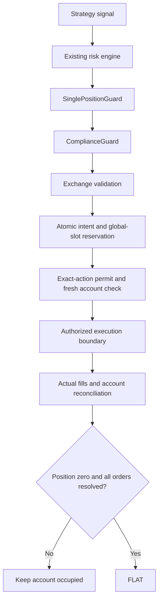

# Team Anchorium — single-position safety and compliance report

Date: 4 October 2026. This report describes implemented software and offline
verification. It does not certify a funded wallet, profitable trading or a
competition committee decision. The runtime remains PAPER with exchange orders
disabled.

## 1. Repository audit

Work took place only in `/Users/adesh/Autonomous Trading Bot - Crypto `, including
the trailing space. The branch is `perpetual-alpha-migration`; the starting commit
is `2c5172ec3149be16be53371c8896c26b0db070c5`. The repository was clean before this
task. Its origin identifies the Crypto repository. The Phase 0 identity and
independent-Git-directory checks passed. The original market repository was not
edited, and no branch, commit, push or deployment was performed.

Before implementation, the full suite passed **1,054 tests**. The initial audit
recorded hashes of all 160 existing Python sources and the freeze manifest.
Strategy-freeze verification passed for the entire signal file, eight protected
methods and 32 parameters. All 12 Phase 0 checks passed.

The existing strategy owner already used a risk policy that permits one position
and at most two new setups per day. The live account reconciler already treated
reported positions, fills, fees and funding as account truth, and the executor
already had durable intents, nonce/clock controls, request budgets, SDK validation
and independent catastrophic protection. PAPER and REPLAY used separate local
ledgers and could not submit exchange orders.

The audit found these gaps in the future signed execution path:

- The final executor had no durable account-wide position reservation. A caller
  supplying a risk permission could reach it without the owner loop's position
  check.
- A validated context contained a single position/open-order snapshot. A change
  during collection or before signing needed an explicit barrier.
- There was no central order classification and full strategy provenance check.
- Durable retries were protected, but duplicate candidates with different intent
  keys needed a central rejection.
- The exchange validator checked its broad price band; a narrower bot policy was
  needed for unusual prices and book participation.
- A generic signing callback did not prove that the action came through a
  compliance decision. Separate processes using different API signers also
  needed an account-level lease.
- Compliance exports and controlled-test exclusions were missing. Technical
  authorization could previously produce a LIVE_READY label without this phase's
  complete real execution certification.

The competition guide describes prohibited self-trading, transfers between teams,
deliberate value transfer, coordinated trading and manipulation. These checks
address what the local bot can inspect; they do not replace organizer review.
[Official participant guide](https://perpetual-alpha26.github.io/docs/#monitored-behaviour)

## 2. Files modified

Paths below are relative to the repository identified in Section 1.

| File | Exact reason |
|---|---|
| `algo-trading-bot/exchange/exchange_rules.py` | Attach complete provenance to risk permissions; collect recent actual fills, trigger-aware orders and independent reference freshness; verify stable account snapshots. |
| `algo-trading-bot/exchange/execution_journal.py` | Reserve the global slot inside the same SQLite transaction as the entry intent. |
| `algo-trading-bot/exchange/hyperliquid_execution.py` | Route entries, exits, replacements, protection and management through central guards; bind exact-action permits; re-read account truth before signing. |
| `algo-trading-bot/exchange/sdk_transport.py` | Require registered permits; restrict SDK methods/actions; acquire a production team-account process lease. |
| `algo-trading-bot/exchange/live_recovery.py` | Revoke the global lock during recovery; detect concurrent actual positions; synchronize verified account truth. |
| `algo-trading-bot/exchange/live_readiness.py` | Keep full LIVE readiness false until a later real controlled-execution certification is implemented and proven. Technical permission remains a separate field. |
| `algo-trading-bot/exchange/safety_report.py` | Expose global position state and compliance evidence; show entries paused while occupied or unknown. |
| `algo-trading-bot/live_execution_session.py` | Link recovery to the guard and supply entry/exit provenance. Signal and fill-management behavior are preserved. |
| `algo-trading-bot/live_session_results.py` | Export compliance evidence and separate classified strategy fills from controlled/manual fills. |
| `algo-trading-bot/test_live_exchange_execution.py` | Add explicit synthetic provenance and trigger-aware fixture responses; require blocked exposure-increasing replacement. |
| `algo-trading-bot/test_crypto_paper_infrastructure.py` | Give its synthetic signal fixture an explicit existing setup classification instead of an unexplained FIXTURE setup. No strategy formula changed. |
| `algo-trading-bot/test_production_reliability.py` | Expect the earlier global POSITION_LIMIT rejection when actual exposure changes. The no-signature assertion remains. |
| `AGENTS.md` | Preserve this phase's safety constraints for subsequent work. |
| `README.md` | Explain guard behavior, exports and deployment limits. |
| `docs/legacy_dependency_inventory.csv` and `.json` | Refresh the maintained occurrence inventory after documentation/source additions. |

The fill-as-truth consumer, the risk engine, the signal brain, the frozen managers,
scanner settings, PAPER executor and REPLAY engine were not rewritten.

## 3. Files created

| File | Responsibility |
|---|---|
| `algo-trading-bot/exchange/single_position_guard.py` | Explicit portfolio states, durable global slot, atomic reservation, generation checks and host account lease. |
| `algo-trading-bot/exchange/compliance_guard.py` | Central classifications/provenance, duplicates, self-cross, prices, liquidity and exact-action capabilities. |
| `algo-trading-bot/exchange/compliance_report.py` | Compliance event exports and evidence-aware summaries. |
| `algo-trading-bot/test_single_position_compliance.py` | 67 new synthetic failure-injection cases with exchange HTTP prohibited. |
| `docs/single_position_compliance_initial_audit_2026-10-04.json` | Starting commit/branch and pre-edit hashes. |
| `docs/single_position_compliance_baseline_2026-10-04.xml` | Full pre-change test results. |
| `docs/single_position_compliance_focused_2026-10-04.xml` | Guard/execution/restart/protection regression results. |
| `docs/single_position_compliance_regression_2026-10-04.xml` | Final full-suite results. |
| `docs/single_position_compliance_validation_2026-10-04.json` | Consolidated final audit, hashes, checks and readiness. |
| `docs/single_position_compliance_synthetic_release_2026-10-04/results/` | Labelled final-version synthetic entry, partial exit, final exit and blocked-order evidence. |
| This report | Plain-language explanation and future roadmap. |

Development XML files are retained as engineering records. The final regression
and validation files establish the delivered result; failed development runs are
not presented as successful certification.

## 4. Single-position enforcement

The account has seven explicit states:

| State | Meaning |
|---|---|
| FLAT | A fresh, reconciled exchange view proves no position or blocking order. |
| ENTRY_PENDING | A durable entry is reserved or unresolved. A second entry is forbidden. |
| LONG / SHORT | Actual signed quantity occupies the one global slot. |
| EXIT_PENDING | An exit/protection order remains unresolved, including after a zero-position snapshot. |
| RECOVERING | Evidence is incomplete or conflicting, or concurrent exposure was detected. |
| UNKNOWN | Startup, disconnect or unavailable/stale account truth. |

Only FLAT permits a new entry. The slot belongs to the entire team account across
the par markets; it is not a separate slot per symbol.



**Partial entry:** if only 0.4 of a requested 1.0 fills, the actual 0.4 occupies
the slot. The unfilled remainder is handled by the existing lifecycle semantics.
There is no additional entry on another market or a new pyramid tranche.

**Partial exit:** submitting an exit does not release the slot. If 0.6 of a 1.0
position exits, the remaining 0.4 still occupies it. A filled response without
reported user fills cannot establish a completed exposure lifecycle. The guard
also keeps the slot while old protection or an ambiguous order remains.

**Direction flip:** the existing strategy still decides whether to flip. Execution
must complete the old exit, reconcile zero actual quantity, resolve old protection
and obtain a new permission. Long-plus-short or cross-market overlap is blocked.

**Restart and reconnect:** a newly constructed guard begins UNKNOWN even when a
saved checkpoint says FLAT. Recovery and account-stream revocations preserve the
durable reservation but remove entry permission. The existing REST recovery and
acknowledged-stream barriers remain in force before entries resume.

**Races:** the global reservation and intent are one SQLite transaction. A
generation counter detects changes during account preflight and between
validation and reservation. The SDK boundary re-reads actual positions and
trigger-aware open orders. Production also acquires an account lease independent
of the API signer, preventing a second local production owner.

The process lease is scoped to this host and operating-system user. It cannot
control another computer, another OS user or manual wallet activity. Deployment
requires one dedicated competition account and one authorized execution owner.
Unexpected external activity causes a pause when observed; exchange snapshots
cannot promise control over an independent external writer.

## 5. ComplianceGuard

Each order is classified exactly once as STRATEGY_ENTRY, STRATEGY_EXIT,
CATASTROPHIC_STOP, PROTECTIVE_EXIT, RECONCILIATION_ACTION or CONTROLLED_TEST_ORDER.
Unknown classifications block transmission.

Strategy provenance contains candidate ID, strategy ID, setup type, completed
signal timestamp, market, direction, reason, risk decision and execution decision.
An ordinary strategy exit also requires its source-position link. Protective
actions require RISK_PROTECTION, an explicit reason and reduce-only semantics.
The existing protection manager still verifies approved geometry and actual size.

The result records allowed/block, code, reason, candidate, checks, classification
and timestamp. Representative codes include:

| Code | Meaning |
|---|---|
| COMPLIANCE_PASS | This component's preflight checks passed; other gates still apply. |
| MISSING_STRATEGY_PROVENANCE | Required identity, timing or decision evidence is absent. |
| MISSING_SOURCE_POSITION | A strategy exit lacks its position link. |
| POSITION_LIMIT / UNKNOWN_ACCOUNT_STATE | The account is occupied or cannot safely be treated as flat. |
| SELF_CROSS_RISK / DUPLICATE_ORDER | Own-order conflict or repeated logical action. |
| ABNORMAL_PRICE / STALE_PRICE_CONTEXT | Price deviates from policy or its references are too old. |
| MARK_ORACLE_DIVERGENCE / BOOK_MANIPULATION_RISK | Entry reference divergence or excessive depth participation. |
| UNEXPLAINED_ORDER / COORDINATED_INPUT_BLOCK | Unsupported purpose/setup or disallowed input provenance. |
| COLLATERAL_TRANSFER_BLOCK / UNAUTHORIZED_TEST_ORDER | Prohibited administration or missing bounded test authorization. |

A CLOID is the exchange client order identifier. The permit binds the validated
asset, side, size, price, reduce-only flag, order type, CLOID and action. Arbitrary
callbacks, unregistered permits, altered wires and unsupported SDK methods are
rejected. A permit also requires the matching persisted intent; entries require
their reserved global slot. The executor supplies the health callback itself, so
an alternate caller cannot replace it with a permissive function. Strong object
identity and bounded expiry keep discarded permit identifiers from being reused.
An allowed local decision still cannot bypass PAPER/false authorization.

## 6. Self-cross defense

Own open orders come from a trigger-aware account query. For a new buy, an own
resting sell priced at or below the buy limit is a conflict. For a new sell, an
own resting buy priced at or above the sell limit is a conflict. The guard blocks
the action and records the reason; it does not blindly cancel unrelated orders.

For example, a reduce-only sell at 100 conflicts with an own resting buy at
100.02. A buy at 100 conflicts with an own resting sell at 99.98. Both are tested.
A non-crossing, legitimate reduce-only action can pass the self-cross check.

Dormant protection is exempt only when it is an identified, tracked, reduce-only
trigger. Unknown or exposure-increasing triggers are blocked. A verified
catastrophic stop does not count as a duplicate ordinary exit, so normal position
management can operate while protection remains in place.

## 7. Off-market defense

Every order records the bid, ask, mid, mark and oracle, and its deviation from
each. The mid is the average of bid/ask; mark and oracle retain their separate
roles. One basis point is 0.01 percent.

These are conservative **local bot limits**, not published committee thresholds:

| Check | Current bound |
|---|---|
| Non-trigger order versus book mid | At most 100 bps, or 1%. |
| Non-trigger order versus oracle | At most 150 bps, or 1.5%. |
| Mark/oracle divergence for new exposure | At most the preserved 50 bps, or 0.5%. |
| Leverage for new exposure | Exactly the preserved 1×. |
| New exposure versus executable best-level depth | At most the preserved 10% participation. |
| Book age | At most 5 seconds. |
| Mark and oracle context age | At most 60 seconds. |

At a mid and oracle of 100, a normal limit near 100 can pass; a limit of 150 is
rejected before signing. No rule upsizes a tiny order to force acceptance.

The current provider receives mark and oracle together in one asset-context
response. Their received-context clock is shared but tracked separately for
validation; it is not claimed to be the exchange's independent oracle-update
timestamp. Missing, future or stale reference clocks block the check.

Approved catastrophic trigger plans may legitimately sit far from the current
book. Their deviations are recorded, but the ordinary non-trigger price bounds
are replaced by the existing approved stop/position/geometry checks. This does
not permit arbitrary unclassified off-market limit orders.

## 8. Competition safety and evidence

The production action/method allowlists contain order placement, modification,
cancellation and fixed-policy leverage management. They contain no transfer,
withdrawal, agent approval or account-mode administration. Tests attempt those
actions and verify that no signed fixture payload is produced.

New orders still require a genuine classified strategy path and risk approval.
No artificial-volume target, team signal feed, price-moving objective or transfer
automation was added. Trade frequency, leverage and the existing signal thresholds
were not increased. These are source-path and offline-test findings, not a claim
that software can infer another participant's intent from public quotes.

The durable journal records passes and blocks. Exports include
`compliance_events.jsonl`, `compliance_summary.json`, `compliance_summary.txt` and
`strategy_performance.json`. A summary distinguishes evaluated candidates,
allowed checks, authorized actions and observed positions. An authorization is
not an exchange fill. Empty, unknown and synthetic evidence cannot produce a
committee or funded-account certification.

The delivered synthetic demonstration has eight evaluations: six passes and two
blocks, consisting of a position-limit block and an abnormal-price block. Its
maximum observed simultaneous position count is one. It includes an entry,
partial exit, final exit and protection lifecycle. **Zero actual exchange orders
were submitted.** Its compliance state is REVIEW_REQUIRED and its account is
explicitly unverified because it is an offline fixture.

The bot's autonomous external-transfer count is zero. Unrelated wallet transfers
are UNKNOWN rather than falsely reported as zero. Controlled test orders need
an operator authorization, objective, timestamp/expiry, expected quantity,
market and exit procedure; they are limited to 50 units of mark-valued notional
and five-minute authorization windows. Their fills and unattributed fills remain
account truth but are excluded from strategy performance statistics. Funding
attribution across mixed manual/test exposure is not certified, so no net
strategy P&L is manufactured.

## 9. Future multi-position plan and phase order

MAX_GLOBAL_POSITIONS remains exactly **1**. Requests for 2, 3, zero or a boolean
value are rejected. No correlation, adaptive sizing or portfolio optimizer was
activated.

The later two-position proposal must first prove the single-position cycle,
partial fills, restart/reconnect, real fees/funding, emergency protection and
enough practice evidence of missed simultaneous opportunities. A later design
would need CorrelationGuard, ExposureManager and PortfolioMarginGuard to address
shared USDPR margin, crypto concentration, gross/net exposure, simultaneous exits
and liquidation coupling. This report documents those requirements only.

The intended progression is:

1. **Infrastructure now:** signed architecture, budgets, nonces, clocks, exchange
   validation, recovery, protection, single-position and compliance barriers.
2. **After funding/whitelisting:** human verification of the team wallet and USDPR,
   API approval, unified mode, agent and fees; read-only reconciliation; separately
   authorized tiny long/short and reduce-only exits; flat verification; cancellation,
   partial-fill, reconnect and crash/restart certification.
3. **Practice:** record the real rejection funnel, frequency, equity, drawdown,
   daily variability and execution quality; compare the preserved baseline.
4. **Competitive research:** evaluate candidate models/ranking/sizing only after
   baseline evidence, with chronological and holdout validation and no automatic
   promotion. Existing isolated research remains isolated.
5. **Scored trading:** freeze the proven strategy and certified execution/risk/
   recovery/compliance configuration. Monitor fills, equity, margin, funding and
   health; do not introduce experimental changes.

Earlier research artifacts remain historical observations at their recorded
source hash. This infrastructure change must not be concealed by rewriting their
hashes or automatically reusing an old sealed model under changed code.

## 10. Strategy integrity

`signal_brain.py` remains byte-for-byte identical to the frozen baseline.

```text
signal_brain.py SHA256
bff940ac5ed35f71ed3dfb537ba15d20dcec35a4e62a938d2f0619c6e9309d83

strategy_freeze.json SHA256
aeda15740802c1082f38f4e69f415f16a77d749a1aa050061026a99120fb9f8b
```

The freeze manifest itself was not edited. Verification covers one full file,
eight protected methods and 32 parameters. VWAP, EMA9/21, ATR, setup decisions,
bias, warmup, cooldown, anti-spam, stops, targets and direction-flip calculations
were not modified. The full-file pre-edit hashes and protected method hashes are
available in the initial audit and unchanged freeze manifest. The same strategy
and fill-management regression suite runs after the infrastructure changes.

## 11. Test results

The pre-change suite passed **1,054 tests** in 260.39 seconds.
The final full suite passed **1,121 tests** in 212.26 seconds, with zero
failures, errors or skipped cases. All **67 new cases** passed.
Of the 160 pre-existing Python files,
148 are byte-for-byte unchanged; the 12 changed files are the nine infrastructure
and three test files listed in Section 2. All protected strategy files, methods
and parameters remain unchanged. The strategy-freeze and all Phase 0 checks pass.

The final focused results are extracted from the full regression, covering
312 cases including all 67 new tests. The dedicated new-case run also passed
all 67 cases. The cases cover first
entry, long/short cross-market rejection, pending entry/exit, partial exposure,
flat reconciliation, restart UNKNOWN, disconnect revocation, account snapshot
changes, SQLite races, generation races, self-crossing, duplicates, timeouts,
missing/unsupported provenance, stale book/mark/oracle clocks, abnormal prices,
thin depth, controlled-test authorization, transfer blocks, forged permits,
altered wires, mandatory durable reservations, fixed executor callbacks,
baseline leverage and account leases across processes/TMPDIR changes.

Existing protection and SIGKILL recovery tests remain included. The generic PAPER,
REPLAY, production lockout, frozen strategy and isolated research suites are
included in the final full regression. Compilation and Git whitespace checks
also passed. Offline signed fixtures use ephemeral keys in memory and prohibit
exchange HTTP; they are engineering evidence rather than trading returns.

To reproduce the checks from this repository:

```bash
cd "/Users/adesh/Autonomous Trading Bot - Crypto "
.venv/bin/python scripts/check_strategy_freeze.py
.venv/bin/python scripts/phase0_check.py
.venv/bin/python -m pytest -q algo-trading-bot/test_single_position_compliance.py
.venv/bin/python -m pytest -q
```

## 12. Remaining blockers

No real funded Team Anchorium account was verified in this task. Wallet funding,
whitelisting, API approval, unified mode, real fee tier, actual controlled long/
short cycles, partial fills, restart/reconnect, protection execution and practice
performance therefore remain unproven.

The new LIVE readiness report deliberately stays false: technical connectivity
or even a future action authorization cannot certify the full controlled
sequence. No real certification record, activation, secret loading or account
administration was performed. Future account testing must be separately
authorized by the user after manual account verification.

The local guard cannot inspect all wallets controlled by team members, determine
cross-team intent or control another computer. Organizer review remains external.
Conservative blocks can delay entries/exits when prices, order state or accounting
are uncertain. The SDK-boundary account reads consume existing API budgets and
remain subject to their reserve/backoff policy; limits were not relaxed.

## 13. Final readiness

```ini
STRATEGY_INTEGRITY       = PASS
SINGLE_POSITION_GUARD    = IMPLEMENTED_AND_OFFLINE_VERIFIED
COMPLIANCE_GUARD        = IMPLEMENTED_AND_OFFLINE_VERIFIED
SELF_CROSS_PROTECTION   = IMPLEMENTED_AND_OFFLINE_VERIFIED
DUPLICATE_PROTECTION    = IMPLEMENTED_AND_OFFLINE_VERIFIED
OFF_MARKET_PROTECTION   = IMPLEMENTED_AND_OFFLINE_VERIFIED
PAPER_READY             = TRUE_OFFLINE_REGRESSION
REPLAY_READY            = TRUE_OFFLINE_REGRESSION
ACCOUNT_READY           = FALSE
LIVE_READY              = FALSE

MAX_GLOBAL_POSITIONS    = 1
EXECUTION_MODE          = PAPER
ALLOW_LIVE_ORDERS       = false
```

The next execution milestone is one separately authorized, fully accounted and
certified real testnet trade cycle after wallet setup. There is no current
permission for exchange writes or multi-position trading.
