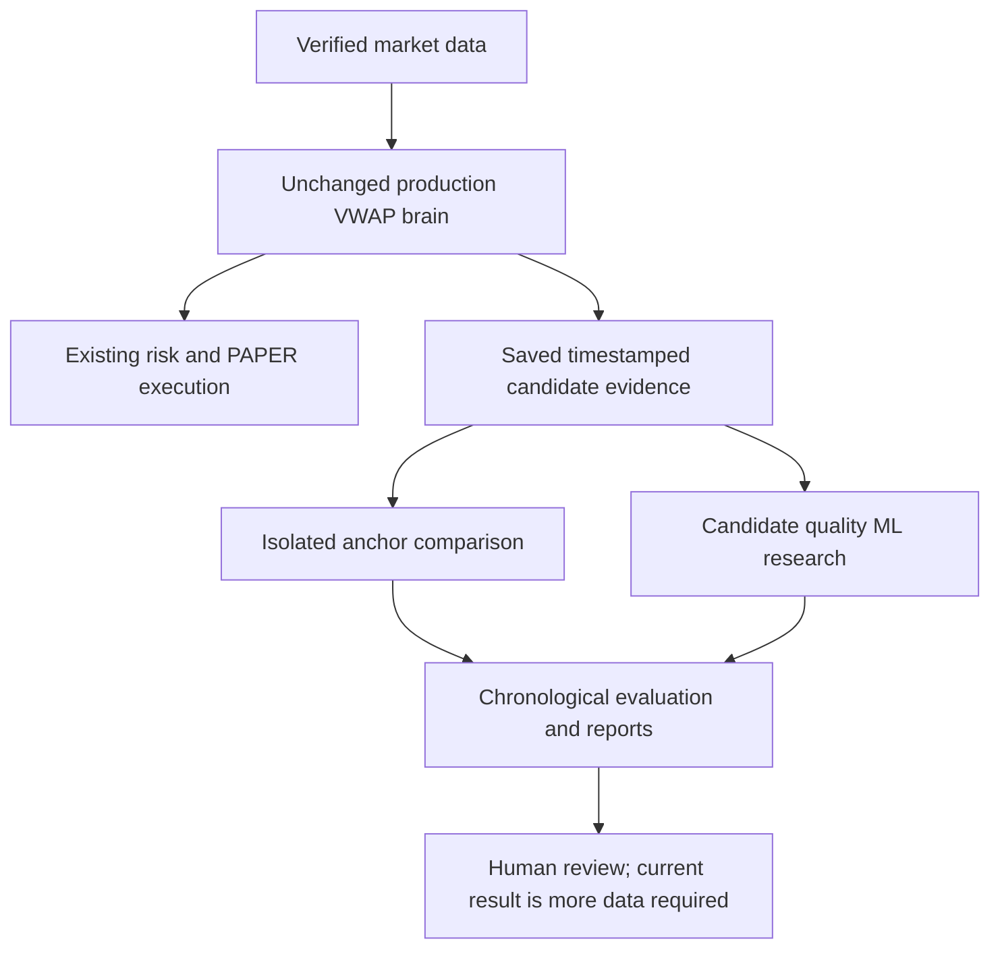

# Team Anchorium — VWAP anchor and ML research engineering report

**Date: 4 October 2026 · Hyperliquid Testnet · HIP-3 DEX `par`**

The isolated research infrastructure is implemented. The production bot remains unchanged. The current evidence supports **MORE_DATA_REQUIRED**, not an improved anchor or a validated AI model. The saved public sample contains ten market observations on one decision date, all stale, and **zero valid strategy candidates or usable outcome labels**. No real exchange orders, wallet operations or production promotion occurred.

This report explains what was built, what the tests establish and what still needs real research evidence. Passing engineering tests means the mechanisms work; it does not mean the strategy makes money.

## 1. Repository audit

The verified Crypto clone is on `perpetual-alpha-migration`. Its pre-task commit was `ee9daecb711a93067df09bdb0ccbf10e293f600d`, and the checkout was clean. The original NSE repository was untouched. Before editing, strategy freeze passed for one protected file, eight methods and 32 parameters. All twelve Phase 0 safety checks passed. The complete existing suite contained **923 passing tests**.

The existing VWAP uses representative price `(high + low + close) / 3`, weighted by per-candle volume and accumulated by UTC date. `FrozenStrategy` supplies completed UTC candles. `SessionManager` permits continuous trading and rejects unvalidated production anchors. `CryptoStrategyState` preserves positions and held-bar state across UTC midnight. Existing stops, targets, bias, cooldown and direction rules remain protected.

An important isolation detail emerged from the audit: the brain's session key controls EMA9, EMA21, volume averages and signal warmup as well as VWAP. Replacing that shared session key would change several experiment variables. This implementation leaves it alone and changes only the VWAP and VWAP-slope assignments in a separate research copy.

Existing infrastructure already supplied the all-market scanner, market snapshots, decision/fill/accounting records, durable opportunity traces, saved public REST replay, checksummed tapes and cost/risk policy manifests. The replay currently supports a complete recorded single cycle; it does not establish a continuous multi-day counterfactual portfolio path.

Existing feature sources include closed-candle indicators, measured spread, depth, imbalance, funding context, open interest, mark/oracle prices and candidate clocks. Their presence in an aggregate trace does not automatically prove every source timestamp. The research bridge accepts timestamped snapshots or leaves the feature unavailable.

The exact gaps were: no pluggable isolated anchor experiment; no candidate feature/label contract; no purged chronological ML partitions; no deterministic calibrated meta-controller; no immutable model lifecycle or four-arm experiment registry. These mechanisms are now implemented.




## 2. Files modified

| Exact path | Reason |
|---|---|
| [AGENTS.md](</Users/adesh/Autonomous Trading Bot - Crypto /AGENTS.md>) | Records the research authorization and the narrow two-assignment adaptation, with production protection intact. |
| [README.md](</Users/adesh/Autonomous Trading Bot - Crypto /README.md>) | Explains research isolation, safe commands, input evidence and current data limitations. |
| [legacy_dependency_inventory.csv](</Users/adesh/Autonomous Trading Bot - Crypto /docs/legacy_dependency_inventory.csv>) | Refreshes source locations after new research/documentation files. |
| [legacy_dependency_inventory.json](</Users/adesh/Autonomous Trading Bot - Crypto /docs/legacy_dependency_inventory.json>) | Refreshes occurrence totals and exclusions. |

No existing production Python file, strategy-freeze manifest, risk rule, execution rule or safety configuration was modified. Final validation checks their hashes against the pre-edit audit rather than relying only on the Git branch name.

## 3. Files created

| Exact path | Responsibility |
|---|---|
| [algo-trading-bot/research_intelligence/__init__.py](</Users/adesh/Autonomous Trading Bot - Crypto /algo-trading-bot/research_intelligence/__init__.py>) | Declares research-only mode; no production integration. |
| [algo-trading-bot/research_intelligence/common.py](</Users/adesh/Autonomous Trading Bot - Crypto /algo-trading-bot/research_intelligence/common.py>) | Source/data hashes, exclusive JSON writes, append-only attempt registry and holdout seals. |
| [algo-trading-bot/research_intelligence/anchors.py](</Users/adesh/Autonomous Trading Bot - Crypto /algo-trading-bot/research_intelligence/anchors.py>) | Immutable reference policies, timezone/DST validation and the separately compiled two-assignment brain adapter. |
| [algo-trading-bot/research_intelligence/dataset.py](</Users/adesh/Autonomous Trading Bot - Crypto /algo-trading-bot/research_intelligence/dataset.py>) | Candidate rows, exact feature provenance, freshness checks, explicit labels and the existing-trace/snapshot bridge. |
| [algo-trading-bot/research_intelligence/splits.py](</Users/adesh/Autonomous Trading Bot - Crypto /algo-trading-bot/research_intelligence/splits.py>) | Ordered train/calibration/validation/holdout windows and outcome purge/embargo. |
| [algo-trading-bot/research_intelligence/metrics.py](</Users/adesh/Autonomous Trading Bot - Crypto /algo-trading-bot/research_intelligence/metrics.py>) | Classification, calibration, conditional after-cost results, market/regime/direction analysis and day-block uncertainty. |
| [algo-trading-bot/research_intelligence/models.py](</Users/adesh/Autonomous Trading Bot - Crypto /algo-trading-bot/research_intelligence/models.py>) | Heuristic controls, logistic and shallow tree support, train-only transforms, calibration, threshold freezing and explanations. |
| [algo-trading-bot/research_intelligence/experiment.py](</Users/adesh/Autonomous Trading Bot - Crypto /algo-trading-bot/research_intelligence/experiment.py>) | Four-arm manifests, immutable run directories, data gates, aggregate outputs and failed-attempt evidence. |
| [algo-trading-bot/test_research_intelligence.py](</Users/adesh/Autonomous Trading Bot - Crypto /algo-trading-bot/test_research_intelligence.py>) | 83 engineering tests using explicitly synthetic fixtures and saved public observations. |
| [scripts/run_strategy_intelligence_research.py](</Users/adesh/Autonomous Trading Bot - Crypto /scripts/run_strategy_intelligence_research.py>) | Offline research command; accepts recorded files, never a wallet or exchange transport. |
| [research/configurations/anchor_policies.json](</Users/adesh/Autonomous Trading Bot - Crypto /research/configurations/anchor_policies.json>) | Source-backed reference hypotheses and explicit unconfigured-market behavior. |
| [research/configurations/experiment_defaults.json](</Users/adesh/Autonomous Trading Bot - Crypto /research/configurations/experiment_defaults.json>) | Fixed sample floors, model types, seed and no-promotion rules. |
| [research/configurations/recorded_public_assumptions_2026-10-02.json](</Users/adesh/Autonomous Trading Bot - Crypto /research/configurations/recorded_public_assumptions_2026-10-02.json>) | An unchanged copy of the historical public-tape risk/fee/scanner assumptions with provenance. |


Audit and verification evidence are saved in [initial audit](</Users/adesh/Autonomous Trading Bot - Crypto /docs/vwap_ml_initial_audit_2026-10-04.json>), [baseline tests](</Users/adesh/Autonomous Trading Bot - Crypto /docs/vwap_ml_research_baseline_2026-10-04.xml>), [focused tests](</Users/adesh/Autonomous Trading Bot - Crypto /docs/vwap_ml_research_focused_2026-10-04.xml>), [final full tests](</Users/adesh/Autonomous Trading Bot - Crypto /docs/vwap_ml_research_regression_2026-10-04.xml>), [strategy parity](</Users/adesh/Autonomous Trading Bot - Crypto /docs/vwap_ml_strategy_parity_2026-10-04.json>) and [consolidated validation](</Users/adesh/Autonomous Trading Bot - Crypto /docs/vwap_ml_research_validation_2026-10-04.json>).

The append-only [experiment registry](</Users/adesh/Autonomous Trading Bot - Crypto /research/experiment_registry.jsonl>) records starts, completions, individual arms and failed attempts. Previous run/model files cannot be silently overwritten. The earlier saved-data artifact directory is retained; both saved runs use the same underlying observations and are not counted as independent evidence.

| Exact output path | Purpose |
|---|---|
| [experiment_manifest.json](</Users/adesh/Autonomous Trading Bot - Crypto /docs/strategy_intelligence_research_2026-10-04-final/experiment_manifest.json>) | Run identity, commit/source/data hashes, controls, policy definitions, recommendation and final flags. |
| [vwap_anchor/experiments.jsonl](</Users/adesh/Autonomous Trading Bot - Crypto /docs/strategy_intelligence_research_2026-10-04-final/vwap_anchor/experiments.jsonl>) | All four declared experiment arms and their conclusions. |
| [vwap_anchor/anchor_results.csv](</Users/adesh/Autonomous Trading Bot - Crypto /docs/strategy_intelligence_research_2026-10-04-final/vwap_anchor/anchor_results.csv>) | Individual saved decision-moment anchor checks. |
| [vwap_anchor/market_results.csv](</Users/adesh/Autonomous Trading Bot - Crypto /docs/strategy_intelligence_research_2026-10-04-final/vwap_anchor/market_results.csv>) | Per-market aggregate observations, valid denominators, LONG/SHORT counts and signal frequency. |
| [vwap_anchor/regime_results.csv](</Users/adesh/Autonomous Trading Bot - Crypto /docs/strategy_intelligence_research_2026-10-04-final/vwap_anchor/regime_results.csv>) | Observable regime context where fresh indicators exist. |
| [ml/candidate_dataset.jsonl](</Users/adesh/Autonomous Trading Bot - Crypto /docs/strategy_intelligence_research_2026-10-04-final/ml/candidate_dataset.jsonl>) | Candidate-level rows; empty for the genuine current sample. |
| [ml/feature_manifest.json](</Users/adesh/Autonomous Trading Bot - Crypto /docs/strategy_intelligence_research_2026-10-04-final/ml/feature_manifest.json>) | All 26 feature definitions, clocks, units, normalization and missing-value rules. |
| [ml/data_quality.json](</Users/adesh/Autonomous Trading Bot - Crypto /docs/strategy_intelligence_research_2026-10-04-final/ml/data_quality.json>) | Candidate/label counts, class balance, dates, markets, missing/stale/duplicate evidence and the fit gate. |
| [ml/split_manifest.json](</Users/adesh/Autonomous Trading Bot - Crypto /docs/strategy_intelligence_research_2026-10-04-final/ml/split_manifest.json>) | Chronological partitions and purges, or explicit insufficient-data status. |
| [ml/model_manifest.json](</Users/adesh/Autonomous Trading Bot - Crypto /docs/strategy_intelligence_research_2026-10-04-final/ml/model_manifest.json>) | Model lifecycle/versions or explicit not-trained status. |
| [ml/model_metrics.json](</Users/adesh/Autonomous Trading Bot - Crypto /docs/strategy_intelligence_research_2026-10-04-final/ml/model_metrics.json>) | Training/validation/holdout metrics and controls when genuine data supports fitting. |
| [ml/calibration.csv](</Users/adesh/Autonomous Trading Bot - Crypto /docs/strategy_intelligence_research_2026-10-04-final/ml/calibration.csv>) | Calibration-bin table; header only when no model can be fitted. |
| [ml/feature_importance.csv](</Users/adesh/Autonomous Trading Bot - Crypto /docs/strategy_intelligence_research_2026-10-04-final/ml/feature_importance.csv>) | Actual coefficient/Gini importances; header only when no model exists. |
| [ml/candidate_explanations.jsonl](</Users/adesh/Autonomous Trading Bot - Crypto /docs/strategy_intelligence_research_2026-10-04-final/ml/candidate_explanations.jsonl>) | Direction-preserving scored recommendations or ML_UNAVAILABLE; empty when there are no candidates. |
| [comparisons/baseline_vs_anchor.csv](</Users/adesh/Autonomous Trading Bot - Crypto /docs/strategy_intelligence_research_2026-10-04-final/comparisons/baseline_vs_anchor.csv>) | Anchor-only comparison with identical recorded controls. |
| [comparisons/baseline_vs_ml.csv](</Users/adesh/Autonomous Trading Bot - Crypto /docs/strategy_intelligence_research_2026-10-04-final/comparisons/baseline_vs_ml.csv>) | ML-only comparison and separate conditional outcome fields. |
| [comparisons/full_experiment_matrix.csv](</Users/adesh/Autonomous Trading Bot - Crypto /docs/strategy_intelligence_research_2026-10-04-final/comparisons/full_experiment_matrix.csv>) | All four arms with missing financial evidence explicitly blank. |
| [reports/vwap_anchor_report.md](</Users/adesh/Autonomous Trading Bot - Crypto /docs/strategy_intelligence_research_2026-10-04-final/reports/vwap_anchor_report.md>) | Easy-to-read anchor research result. |
| [reports/ml_meta_controller_report.md](</Users/adesh/Autonomous Trading Bot - Crypto /docs/strategy_intelligence_research_2026-10-04-final/reports/ml_meta_controller_report.md>) | Easy-to-read candidate/model data result. |
| [reports/competition_research_summary.md](</Users/adesh/Autonomous Trading Bot - Crypto /docs/strategy_intelligence_research_2026-10-04-final/reports/competition_research_summary.md>) | Defensible jury summary and recommendation. |


## 4. VWAP research

`VWAP_BASELINE_UTC` is always the exact UTC-midnight control. Its normal evaluation calls the unchanged brain directly. An experimental `VWAPAnchorPolicy` contains policy ID, symbol, anchor type, timezone, local reference time, source, rationale, research enablement and calendar semantics. Policies are immutable. Rolling and multi-anchor modes are not enabled; unsupported types raise an error.

The separate adapter compiles the locally trusted, hash-verified brain source into its own namespace. It replaces only the right-hand sides that assign `VWAP` and `VWAP_Slope`. The representative price, volume weighting and slope formula remain the same; their anchor boundaries follow the experimental policy. EMA, ATR, volume MA, UTC warmup, signal conditions and anti-spam logic stay fixed. Production functions are never patched or reassigned.

The configured hypotheses are:

| Asset | Daily reference | Interpretation |
|---|---|---|
| `par:SP500` | 09:30 America/New_York | US cash-market information reference, with DST. |
| `par:EWY` | 09:00 Asia/Seoul | Korean underlying-equity information reference. |
| `par:EWJ` | 09:00 Asia/Tokyo | Japanese underlying-equity reference. |
| BTC, ETH, HYPE, BRENT, GOLD, USDEUR, USDJPY | No new session configured | Retain UTC as the explicit control; do not invent a session. |

The reference times are supported by [NYSE](https://www.nyse.com/markets/hours-calendars), [KRX](https://global.krx.co.kr/contents/GLB/06/0604/0604010100/GLB0604010100T2.jsp) and [Japan Exchange Group](https://www.jpx.co.jp/english/equities/trading/domestic/01.html). Their use for these perpetual contracts is a research hypothesis. They are **not official `par` trading-session facts**. Korean and Japanese 09:00 both equal UTC midnight, so those definitions intentionally act as identical-boundary controls rather than pretending to be different experiments.

These policies reset at the documented wall-clock time on every calendar date, including weekends and holidays. They do not implement official exchange calendars or permission restrictions. Adding holiday/session-calendar behavior would require another documented hypothesis. Ambiguous or nonexistent local times fail explicitly; the configured reference times have timezone-aware DST conversion.

Anchor reset never closes a position. The research evaluator returns indicators and observations, not orders. Production management and its overnight behavior remain unchanged. Missing bars are rejected, not inserted. Incomplete history before the current anchor is marked truncated and cannot establish a valid full-anchor observation.

## 5. Experiment methodology

The genuine input is the saved public observation session from **2 October 2026**, covering all ten `par` markets. Historical candle windows can span two dates, but they were received at the saved scan time. That does not prove those values were available for historical decisions. Research evaluates only the recorded decision moments; it does not turn every old candle into a retroactive training opportunity.

There are ten saved market moments and twenty anchor checks: one UTC and one session/control check for each market. All twenty fail completed-candle freshness. Consequently, there are no valid comparisons of signal quality, executed trade quality or after-cost profitability.

Every experiment carries the same archived fee/risk/scanner controls and their hash. Those historical parameters include maker fee 0.03%, taker fee 0.09%, scanner ATR 0.40%, maximum spread 15 bps, 300 history bars and Top-3. The archived slippage assumption is 5 bps. These are recorded controls, not a new verification of current fees or a funded account. Outcomes must match the same assumption hash. Funding costs require reported/recorded cashflows; absence stays unknown.

Candidate evaluation uses explicit chronological boundaries. Where enough dates exist and no boundaries are supplied, the fixed rule assigns the earliest 60% of observed dates to training, the next 10% to calibration, the next 10% to threshold validation and the last 20% to holdout. It uses dates, never outcome optimization or random shuffling. Current data cannot establish those windows, so no artificial split or holdout score is produced.

Conditional outcome metrics include win rate, average win/loss, expectancy, gross/net result, fees, slippage, funding, realized drawdown, direction/market/regime breakdown and cost stress. Full portfolio net result, mark-equity drawdown, daily equity volatility and time in market need an actual recorded portfolio path. They remain null when absent. A subset of profitable candidate outcomes cannot establish how an alternative policy would have competed for capital or filled.

## 6. ML dataset

One row means **one valid deterministic strategy candidate**, with a unique candidate ID. It does not mean every candle or every scanner check. The candidate retains its original LONG/SHORT direction and setup type. No model predicts the opposite direction.

There are twenty numeric feature slots and six categorical slots. Numeric features cover ATR fraction, VWAP distance/slope, EMA9/EMA21 and separation, observed candles since anchor, realized volatility, spread, bid/ask/total depth, imbalance, estimated slippage, liquidity, funding, open interest, mark/oracle difference, UTC hour and weekday. Categorical features cover market, asset class, setup, direction, daily bias and anchor program identity. Unavailable optional features remain null.

Required scoring features are ATR fraction, VWAP distance, EMA separation and spread. If one is absent or stale, the result is `ML_UNAVAILABLE` with no confidence. Optional numeric inputs use a training-only median and a separate missing indicator. If a feature was wholly absent during training, the recorded placeholder is zero with its missing indicator; this is disclosed preprocessing, not a claim that the missing market value was zero. Categorical vocabularies are fitted only on training data, and unseen markets are explicitly counted.

The primary label is `POSITIVE_NET_OUTCOME`: one when completed gross result minus fees, slippage and funding cost is positive; zero otherwise. Zero-result observations are reported separately from strictly negative outcomes. Features never include the outcome, exit price or any other future field.

An outcome must identify the candidate, market, direction, anchor policy, later completion time, entry/exit fill IDs, observed executable-BBO fill model, frozen management version and unchanged cost/risk assumption hash. Missing cost components cannot become a zero-cost label. These are recorded evidence contracts; linked receipts still need independent audit before a performance claim or promotion.

Executed, paper-executable, rejected and counterfactual candidates are distinct. A rejected candidate receives no label. A credible separately recorded counterfactual paper execution may have an explicitly conditional label; it is never presented as an actual exchange fill.

Current quality is **zero candidate rows, zero usable labels, zero positives and zero negatives**. Class balance is unknown. There are ten ignored all-market traces because none contains a valid setup. Zero missing-feature counts in this empty dataset do not prove feature completeness.

The fixed fit floor requires 500 usable labeled candidates, twenty dates, three markets, at least 100 positive and 100 strictly negative outcomes, both directions, and adequate rows/classes in each split. These are conservative engineering floors, not statistical proof. The current run returns `INSUFFICIENT_DATA` and creates no trained model artifact.

## 7. Leakage audit

Every non-null feature must prove:

```text
source_ms <= available_ms <= decision_ms
```

Features also carry source description and exact units. Candle inputs must be completed, ordered, contiguous and received before the saved decision. Book features use the reported order-book clock and saved snapshot availability. Funding/mark/open-interest context uses the explicitly recorded local observation clock; the code does not invent an exchange timestamp for an API context that has none.

Freshness limits are explicit: five seconds for book/spread/depth and executable slippage context; sixty seconds for funding/mark/open-interest context; two minutes for completed-candle indicators. Unknown or stale values remain unavailable. Spread is recomputed from contemporaneous bid/ask and checked against the saved snapshot value. The feature manifest documents each normalization formula; it does not silently mix the scanner's VWAP-distance denominator with the ML denominator.

Labels are stored separately and end after the decision. Outcome intervals crossing the next split, or entering its one-hour embargo, are purged from the earlier split. This rule applies between training, calibration, validation and holdout. A candidate can appear in only one partition.

Imputation, scaling and categorical encoding fit only on training rows. Calibration fits only on earlier validation rows. Threshold selection uses only later validation rows. Changing held-out labels/features in tests leaves weights, transforms, calibration and threshold unchanged. A UTC model cannot silently score a different session-anchor program.

Weights, calibration and threshold are written immutably before holdout scoring. A ledger seals the holdout dataset/specification against later changes in the same registry. Identical replay can verify reproducibility; a different specification is rejected. Copying datasets or using another registry is outside this local governance mechanism and must not be used to retune against inspected holdout results.

## 8. Model results

The implemented comparison includes a no-ML control, a prespecified measured ATR/spread heuristic, L2-regularized logistic regression and a shallow depth-three probability tree. These numerical models use existing NumPy; no neural network, LLM, external service or new training dependency was introduced.

Logistic fitting uses fixed iterations and learning rate. The tree uses deterministic impurity splits and minimum leaf size. Raw probabilities are calibrated through a recorded Platt-logit transform using earlier validation data. Four prespecified confidence thresholds are compared on later validation conditional outcomes, with an acceptance-count floor and realized-drawdown constraint. The chosen threshold is frozen before holdout.

Reports support precision, recall, tie-correct ROC-AUC, average-precision PR area, confusion matrix, acceptance rate, Brier score and calibration bins. Training and threshold-selection results are labeled as such; they are not presented as untouched holdout evidence. Controls use the same split and cost components as each model. Per-market holdout classification, direction/regime outcome breakdowns and unseen-market counts are included when data exists.

Explanations are generated from actual standardized logistic coefficient contributions or actual tree paths. They are not invented narrative reasons. Importance uses recorded coefficient magnitudes or training Gini gains; those diagnostics are not causal explanations. Candidate records show model version, confidence, threshold, feature values, direction, regime, risk status and research-only recommendation.

**No model was fitted on the genuine public sample.** Validation performance, holdout performance, calibration quality and per-market improvement are unknown. Synthetic fixtures exercise both algorithms, artifacts and scoring; they are software tests, not trading-performance evidence.

## 9. Full experiment matrix

| Arm | Changed research variable | Genuine result |
|---|---|---|
| UTC / no ML | None; exact baseline control | INCONCLUSIVE: stale observations, no candidate outcomes. |
| Session / no ML | Documented VWAP reference and its slope only | INCONCLUSIVE: no fresh anchor evidence or portfolio outcomes. |
| UTC / ML | Candidate permission recommendation only | INSUFFICIENT_DATA: no model fitted. |
| Session / ML | Separately evaluated anchor and candidate filter | INSUFFICIENT_DATA: no session model or combined holdout. |

Every arm has the same archived assumption hash. Financial fields remain unknown. Conditional recorded-outcome fields are separate from full portfolio results. There is no automatic assumption that the best anchor and best ML model form the best combination.

## 10. Recommendation

**MORE_DATA_REQUIRED. Keep the current UTC production baseline.**

Collect candidate-level PAPER evidence over multiple dates, markets, LONG/SHORT setups, volatility/trend regimes and UTC hours. Preserve timestamped indicator/book/context observations and linked actual paper fills, management transitions, fees and funding. Verify the recorded cost assumptions and retain a complete portfolio path if portfolio comparisons are intended.

Before training, approve the research definitions and register the chronological windows. Fit the fixed models on earlier evidence, calibrate and choose thresholds using validation only, then evaluate the untouched holdout once. Examine costs, mark drawdown, daily volatility, asset/day concentration and missing-input behavior. More trades alone are not a promotion criterion.

The current framework reports conditional candidate outcomes. A complete alternative portfolio replay with concurrent capital/risk constraints is still required to establish an anchor or ML policy's actual portfolio improvement. No production promotion is recommended here.

## 11. Strategy integrity

`signal_brain.py` is unchanged byte for byte:

```text
bff940ac5ed35f71ed3dfb537ba15d20dcec35a4e62a938d2f0619c6e9309d83
```

The freeze manifest remains unchanged, with SHA-256 `aeda15740802c1082f38f4e69f415f16a77d749a1aa050061026a99120fb9f8b`. Freeze verifies one whole file, eight methods and 32 parameters against `nse-working-baseline`. The initial audit and validation record every protected method hash.

The same six parity fixtures, totaling 2,050 candles and seventeen output columns, match the pre-task source exactly. All existing production Python files remain hash-identical. Research is absent from production imports and has no exchange client, signer, submission method or execution permission. Its models retain candidate direction.

Production scanner ATR 0.40%, spread 15 bps, history 300 and Top-3 remain unchanged. PAPER and REPLAY behavior are protected by the complete existing regression suite. Existing account readiness, startup recovery and signed-action lockouts are untouched.

## 12. Test results

| Verification | Result |
|---|---|
| Existing baseline | **923 passed, zero failures** |
| New research tests | **83 passed, zero failures** |
| Final full suite | **1,006 passed, zero failures, zero errors, zero skipped** in 117.63 seconds |
| Strategy freeze | **1 protected file, 8 methods, 32 parameters passed** |
| Phase 0 | **12 checks passed** |
| Pre-task/current strategy parity | **6 fixtures, 2,050 candles, 17 output columns identical** |
| Existing production Python source hashes | **All unchanged** |
| Genuine research fit | **Correctly refused: zero valid/labeled candidates** |
| Real exchange submissions | **0** |

The 83 new tests are included in the full total. Synthetic model-fit fixtures verify mechanisms only. The previously existing PAPER, REPLAY, account recovery, crash-injection and execution-lockout tests are retained and pass.

The new tests cover exact UTC output parity, unchanged EMA/ATR/volume controls, reference boundaries, prefix causality, duplicates/gaps, timezones/DST, invalid local times and position survival across midnight. Feature tests cover timestamp inequalities, stale/unknown inputs, units, explicit direction, source snapshots, funding clocks and label lineage.

ML tests cover disjoint ordered partitions, outcome purge, train-only transforms, missing/unseen inputs, held-out-data independence, calibrated scoring, exact model identity, malformed artifacts, unavailable models and deterministic threshold decisions. Experiment tests verify saved-data insufficiency, all four arms, per-market denominators, registry failure evidence, common-cost controls, holdout seals and no exchange capability.

Synthetic outcomes and fills are explicitly test fixtures. They do not count toward the genuine dataset or support a profitability claim.

## 13. Jury evidence

The technically defensible work is the experimental design and its implementation: a protected deterministic strategy; a narrow anchor intervention that avoids accidentally changing EMA; explicit candidate-level provenance; chronological leakage defenses; two interpretable numerical models; calibration and explanations; cost-aware conditional evaluation; immutable versions; and a complete registry that retains unsuccessful/inconclusive attempts.

This is an explainable candidate-quality layer rather than a black-box BUY/SELL predictor. The jury can inspect how evidence passes from the strategy to context, scoring and research recommendations. The production bot remains separately protected.

The defensible current finding is that the available saved sample cannot validate either idea. There is no established AI improvement, competition score, funded-wallet return or winning anchor to advertise. Reproducibility and honest limitations are part of the evidence.

## 14. Final status

```text
BASELINE_PRESERVED         = TRUE
VWAP_RESEARCH_READY       = TRUE
SESSION_ANCHOR_VALIDATED  = FALSE
ML_DATA_READY             = FALSE
ML_MODEL_VALIDATED        = FALSE
HOLDOUT_COMPLETE          = FALSE
PROMOTION_RECOMMENDED     = FALSE
PRODUCTION_CHANGED        = FALSE
```

`VWAP_RESEARCH_READY` means the isolated policy/comparison infrastructure and engineering tests are available. It does not mean that an anchor outperformed UTC. ML data/model/holdout flags describe the genuine current evidence, not synthetic fixtures.

`EXECUTION_MODE=PAPER` and `ALLOW_LIVE_ORDERS=false` remain enforced. Account and LIVE readiness are not granted. No actual exchange submission, team-wallet secret, account administration, commit or push was performed.
